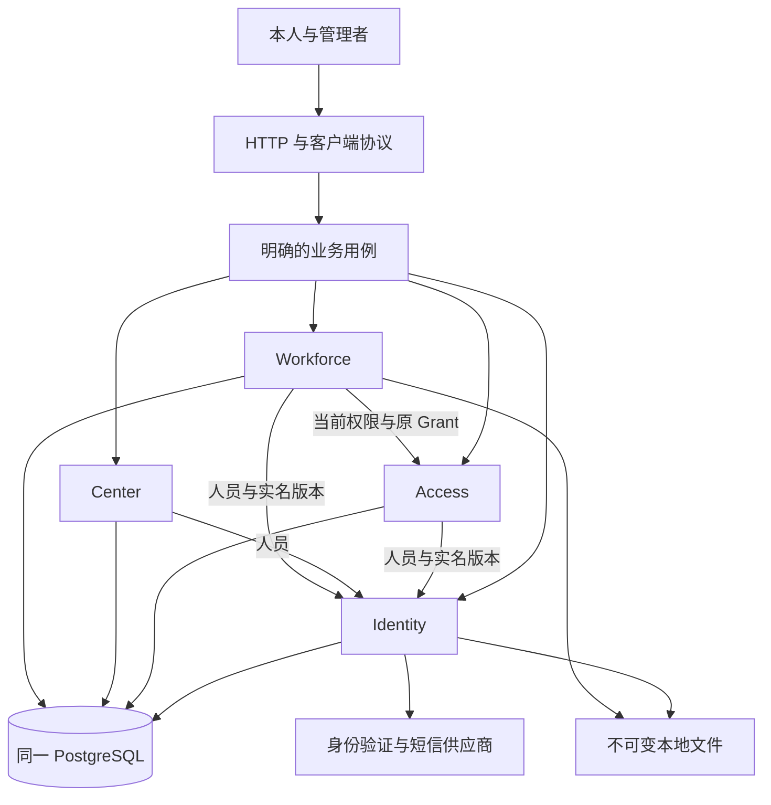
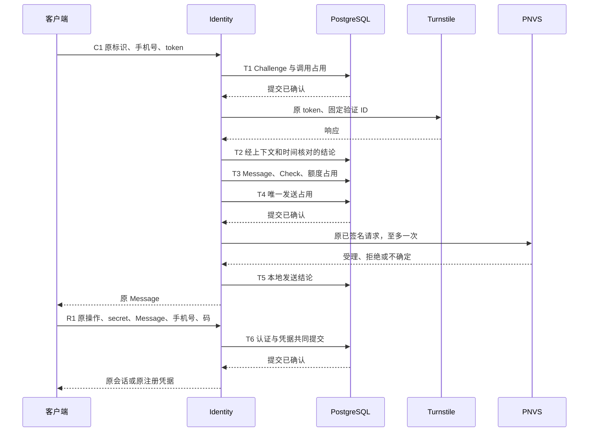

# Nucleus 架构

状态：当前目标架构，尚未完整实施。本文拥有能力与事实边界、共同事务、执行寿命、恢复、文件后果协调、类型和 crate 组织。各业务专题拥有办理条件、输入、状态、永久事实及响应细则。[文档导航](README.md)记录实际交付状态，[交付顺序](engineering/delivery.md)规定设计与实施边界。

## 业务范围与事实所有权

业务后端只运行一个应用实例、一个应用进程，使用一个 PostgreSQL 和本地持久文件。网站独立构建和托管，交付归属见[网站与后端边界](http/site.md#托管与路由归属)。并发请求、后台工作、普通重启、响应丢失、提交未知，以及文件发布和清理中断属于运行范围。旧系统兼容、数据迁移、共存、切换、文件丢失、备份、灾难恢复和 Schedule 均不属于本轮范围。

| 能力      | 解决的问题                             | 拥有的事实                                                              | 主要消费者                               |
| --------- | -------------------------------------- | ----------------------------------------------------------------------- | ---------------------------------------- |
| Identity  | 人是谁、当前账户是谁、怎样证明本次身份 | Person、实名 Revision、Account、认证、Session、绑定、头像和账户生命周期 | 本人入口、全部当前资格检查、永久历史引用 |
| Access    | 谁能办理什么、谁参与 Workforce         | 权限目录、角色定义、指派、Grant、暂停恢复、结束和邀请                   | 管理办理、领域准入、编号和工牌           |
| Center    | 人员政治面貌档案                       | 首次填写、更正及永久取值历史                                            | 本人和有权管理读取                       |
| Workforce | 人员编号与工牌办理                     | 编号、目录、模板、照片、申请、固定提交、审批、Render、Badge、Delivery   | 本人、审批者、制作及发放人员             |
| Platform  | 提供受控技术操作                       | 连接、密码算法和文件操作本身，不拥有业务结论                            | 业务库与两个入口                         |
| 入口      | 装配能力并处理运行边界                 | 环境和文件来源、HTTP 适配、进程生命周期、部署命令                       | 在线服务和停机运维                       |



Person 是永久人员身份，Account 是当前登录占用，Grant 是一次领域参与。注销释放账户占用，保留原人员与历史；同号码重新注册建立新 Person。结束后重新加入建立新 Grant。相同自然人、手机号或证件号不自动转移历史和资格。

账户可登录、领域可参与、管理者可办理分别判断。权限与等级共同约束办理；机构等级与 Workforce 等级不互相比较。恢复账户不恢复旧会话，恢复 Grant 不建立新授权。编号不随账户注销或 Grant 结束自动释放。

Submission 固定人工确认内容，Badge 表示已经接纳的永久成品，Delivery 表示成功保存的实际发放。三者不能相互代替。本人历史不返回办理人身份；管理读取按当前权限裁剪。永久保存不授予永久读取权。

当前没有机构业务档案期限。实名版本与更正、注销、角色和授权变化、邀请码接纳、政治面貌、编号、工牌申请结果、成品与发放按所属规则永久保留。属于本人且本人可见的内容不按年龄自动删除。技术清理不能缩短业务保留期；制定档案期限须先修改所属业务规则。

原操作者失权或注销不改写旧事实。有权管理者按当前资格读取；曾经经办、过去有权或持有相同证件号码不产生当前读取权。本人投影保留本人事实与生效时间，隐藏办理人身份；不因技术归档改变人员归属。

具体规则见 [Identity](identity/person.md)、[Access](access/grants.md)、[Center](center/affiliation.md) 及 [Workforce](workforce/applications.md)。[业务总览](overview.md)提供办理路径。

## 用例与事务边界

用例拥有事务开始、提交和结局处理。参与能力接收同一个事务，完成所属查询、判断与写入。能力不得独立提交半份共同结果。固定查询不外呼、不重试、不记录最终失败。

固定查询区分可靠缺席与查询失败。必有事实缺失属于依赖或完整性故障；异常存储事实不得伪装成输入错误、错误凭据或确定业务拒绝。HTTP 适配和后台入口都不能绕过所属用例的当前权限、事实与原操作检查。

| 用例           | 同一事务必须成立的事实                                                               | 分阶段部分                                   |
| -------------- | ------------------------------------------------------------------------------------ | -------------------------------------------- |
| C1 发码        | 每个阶段的原证明、调用占用、结论或 Message/Check 配对                                | 校验、发送许可、发送占用、供应商结果分别推进 |
| R1 认证        | 原证明与输入、认证结论、计错或消费、会话交接或注册凭据                               | 无外呼，采用单事务                           |
| R2 注册        | 人员、实名首版、账户、号码占用、默认头像关系、默认机构指派、会话、凭据消费和完成     | 默认头像使用已核验的发布资源                 |
| 邀请接纳       | 当前准入、容量、Acceptance、Grant、首条指派及当前关系                                | 无异步补建授权                               |
| 暂停、换号     | 本次事实、当前状态变化、当次会话撤销及交接材料移除                                   | 前置发码分别遵守 C1                          |
| 注销           | Cancellation、账户和访问材料移除、当前角色移除、授权结束后果、无保护照片进入删除状态 | 外呼和文件收尾在事务外                       |
| 实名更正       | 新 Revision、更正事实、当前指针、当前证件占用                                        | 不改旧申请和其他能力事实                     |
| 编号撤销或恢复 | 涉及的一人或两人的历史、当前指针与号码占用                                           | 不分段释放和重新分配                         |
| 批准申请       | Review、approved 阶段、首个 active Render                                            | 后台排版和计算                               |
| 成品接纳       | Badge、Layout、Render.successful、永久材料保护                                       | 候选文件先持久发布                           |
| 实际发放       | Delivery、Application.completed、原 Grant 内发放序号                                 | 实体制作在事务外                             |

外部调用、图像计算、完整文件传输和人工等待不占业务事务。结果接纳重新检查当前身份、原来源、版本和资格。原操作成功的回读不重复执行共同后果。

### C1 与 R1

C1 的原身份由 Challenge 拥有。客户端在首次发送前保存原 Operation-Id、手机号和原 token。widget 重置只影响下一次校验，不替换原材料。供应商 token 过期也不撤销已形成的本地事实。



各阶段的业务字段、期限、额度和继续条件由[短信认证](identity/authentication.md)拥有。发送工作独占其执行资格；重复 HTTP 请求只有核验和读取资格。Turnstile 重试沿用原验证 ID、次数和截止。不同原操作复用同一 token，由本地跨保留密钥版本的占用检查拒绝。

Message 许可提交后即消耗额度，并决定最新验证码。原发送工作只在发送占用提交已确认后调用 PNVS。供应商 OutId 仅用于关联，不能承担防重。已验证的请求直接发送，不重新编码或重签。

验证码只在原工作内短暂保留，数据库保存 Check HMAC。新进程不补发，因此数据库不保存验证码密文。许可存在但没有发送占用，旧工作结束后归为 failed；存在发送占用而可信结果丢失，归为 unknown。两者均不返还额度。

R1 在一笔事务中判断 Check。无效消息不计错；有效码的错误猜测计错一次并保存原拒绝。正确码被消费后，正常账户得到会话，暂停账户得到拒绝，无账户得到注册凭据。原结果重放不重新计错、签发或续期。

### 注册

注册用例从可信注册凭据取得手机号和实际应用来源。输入只提供原操作、凭据证明、实名与传递方式。原结果匹配先于新办理资格判断。

事务锁定原操作、注册凭据和号码占用，锁后重查期限、额度及唯一性。Identity 建立人员、实名和账户，Access 建立默认机构指派，再保存会话、交接、凭据消费和完成。任一步失败整笔回滚。不同手机号争用同一身份证号时，只允许一笔注册成功。

首次管理员由[停机初始化](operations/access.md)在空业务库共同建立人员、账户、系统角色和初始指派。初始化不签发在线会话，管理员通过正常认证进入服务。

### 注销与晚到结果

注销的[业务后果](identity/cancellation.md)在一笔事务成立。事务不等待正在外呼的供应商。相关工作在接纳时重新核对原人员、原账户、原会话或绑定修订；注销先提交时，晚到结果不得建立绑定、会话或账户。

协议占用独立承担防重责任，不能随当前账户级联消失。历史捕获的账户或会话标识只用于原身份比较，不表示当前关系存在。注销移除能够恢复旧账户访问的材料，保留必要协议父事实、占用和计数。

已进入数据库的冲突写入按共同锁顺序裁决。文件和计算工作只有真正结束后才能释放相关资源；注销不等待这些工作完成业务成功，也不直接删除仍被使用的候选文件。

## 并发协调

### 锁与决定性读取

每笔写事务使用 READ COMMITTED，依次取得运行共享屏障、原操作锁、权限范围保护及业务对象锁。原操作锁必须先收到成功确认，随后才发送任何业务修改；禁止把取得锁和修改流水发送。锁等待结束后，用新的语句读取决定性事实。

业务对象顺序固定为：外部 token/code 占用；人员和账户；手机号与身份证号占用；来源与部署额度；会话、Message/Check 和注册凭据；Grant；编号池和编号；配置、申请和资源。同类多个对象按规范键排序。权限范围保护按固定 scope 顺序排在这些对象之前。不涉及的锁跳过。初次查询只提供定位线索；锁后发现集合变化，回滚后以完整集合有限重试。

已有行使用与修改相冲突的行锁。尚不存在的号码占用、原操作或 token 使用事务级 advisory lock。稳定对象键不依赖活动密钥；哈希碰撞只增加等待，完整输入仍另行核对。唯一约束是占用的最终保护。

机构与 Workforce 各有权限定义保护。用权及指派取得共享保护，修改角色定义取得独占保护，再重新读取当前持有人与等级。普通用权可以并行，角色定义修改不会穿过旧权限检查。账户或 Grant 的资格读取使用共享行锁，改变状态使用排他行锁；同一对象的独立读取不机械串行。

死锁或序列化冲突只在确认原事务结束后有限重试完整本地事务。未知提交先恢复；任何自动重试都不能再次调用已经占用的外部动作。实际锁集合与预算随各切片验证，不由包名推断独立性。

### 进程内工作与容量

普通查询、输入解析和纯预检查随 HTTP 请求直接执行。写用例在进入事务前取得有界工作名额，交给运行设施持有执行寿命。HTTP 只等待结果；等待取消不取消已经接纳的工作。即使单条本地写入也可能在提交后丢失响应，因此写入统一保留可观察的执行结束边界。代价是一次任务交接和有界登记；用例函数仍直接推进事务。

工作登记按能力、动作家族和原操作定位。同一原操作只有一个执行者。每个等待者分别核验原证明和输入，不能仅凭 Operation-Id 得到进度。工作登记保存句柄和必要上下文，不作为持久业务证明。

| 组件                   | 实际消费者                     | 必要性                             |
| ---------------------- | ------------------------------ | ---------------------------------- |
| 原操作登记             | 写用例、重复请求、恢复者       | 保持唯一执行者，避免第二个外呼工作 |
| 任务句柄集合           | 停止、panic 和异常收尾         | 给出实际执行结束边界               |
| 有界许可               | 数据库办理、供应商、图像和传输 | 限制真实资源占用，超时不提前归还   |
| 独立恢复连接           | 未知提交、启动核验             | 普通池耗尽时仍能核对               |
| active Render 查询     | 工牌后台执行                   | 已批准工作不依赖客户端再次访问     |
| 所属发布意图与删除状态 | 文件恢复和清理                 | 发现已承诺的文件后果               |

用例仍是直接的顺序函数。运行设施不解释验证码、角色或申请状态，不保存通用命令、通用 job 或通用执行表。明确用例承担自己的阶段分支和错误处理。只共享连接结局、工作寿命、容量和停止原语。

每种外呼、图像和传输许可由消费能力定义。没有许可时拒绝或按所属有界等待预算处理，不建立无限队列。阻塞计算持有许可直到实际退出；取消信号和等待超时不能提前释放许可。

## 原操作与恢复

### 原操作识别与保留

每个动作家族拥有原标识、封闭 action、规范输入及证明规则。原标识定位办理，不授予认证或历史读取权。先核对原证明，再比较原输入，最后决定本次可交付结果。同键异 action、目标、版本或规范输入返回 request_mismatch。

永久业务事实直接保存 Operation-Id，不再复制通用成功回执。需要固定重放的拒绝由所属用例声明，例如验证码错误；格式、认证、权限和依赖错误不自动变成永久业务历史。可变配置的完成定位由[配置原请求](workforce/completions.md)拥有。

短期结果仅在所属保留期内承担原操作识别。期限覆盖原结果恢复、防重、额度统计和真实引用。责任结束后删除完整记录，不另建永久标识集合。已有永久业务事实仍按所属业务期限保留，其中的 Operation-Id 继续定位原完成。

UUID 不提供可信接纳时间。记录清理后，服务无法区分旧标识与首次使用的标识，不再保证返回原结果或固定的过期响应。此时请求重新满足所属用例的新办理条件；旧标识不授予资格。客户端在恢复期限内使用原材料，期满停止自动重试。跨表动作家族在原操作锁下检查保留的封闭成员，以固定约束保护唯一性。清理与办理采用相同原操作协调。

### 未知提交

HTTP 等待失败、供应商结果未知和数据库提交未知分别处理。连接异常不证明回滚，业务事务回滚也不证明外部动作没有发生。

1. 原工作停止推进后续阶段，保留原操作归属及相关候选资源。
2. 将原连接移出池，停止并等待驱动结束；不把有疑义的连接交给其他请求。
3. 独立恢复连接取得同一原操作事务锁，等待可能仍在运行的旧事务结束。
4. 锁后用新语句读取本阶段的持久完成及必要配对事实。
5. 所有者解释原成功、确定未提交或仍然未知，再决定允许的后续动作。

第一笔事务在修改前已确认取得原操作锁。恢复期间原工作不能再发新命令，同操作也不能另起写者。若原锁未取得，协议保证尚未发送修改。驱动结束不单独证明 PostgreSQL 后端结束，恢复锁提供数据库边界。

已提交事实允许后续合法办理改变当前状态。因此恢复核对原完成，不要求全部当前指针还保持原成功时的值。后续修改和清理不得抹去仍承担恢复责任的证据。删除恢复绑定实际尝试删除的实体身份及记录组，先结束旧连接，再跨原操作锁核对整组是否仍在。原组全部删除才确认删除完成；同一 Operation-Id 下的新实体不属于原删除。其他删除后果仍使用所属删除意图，不能用一次查无记录推断业务回滚。

未知范围默认限定在原操作。其他事务通过业务对象锁等待数据库实际结局，并在新语句中读取当前事实。数据库或密钥整体不可用时停止依赖能力；事实矛盾或执行归属丢失时关闭受影响写入。无法界定影响范围时结束进程，不继续宣称可靠服务。

运行中单笔未知提交不排空所有 Identity 工作。启动和停机维护仍使用独占运行屏障，等待旧共享屏障事务结束。恢复连接断开后重新取得适用锁，不能沿用上一条连接的证明。

### 清理

到期只产生清理候选。清理者取得原操作与对象协调，核对执行已结束、阶段可解释、恢复期限、统计窗口、真实引用和外部占用责任。未知、在途或矛盾对象保留，不能因年龄推断孤立。

每笔删除事务也有明确结果依据。批次标识不代替被删除对象的原操作。技术清理不删除永久历史，不返还邀请累计容量，不使原 code 再次可交换。文件删除遵守下一节协议。

## 文件与数据库后果

### 发布与接纳

每个资源所有者保存自己的 SQL 发布意图。头像意图绑定账户原修订，Badge 意图绑定 Render 和执行代次；共同字段包括原操作、候选 ID、执行身份及恢复所需元数据。意图不接收任意任务类型、JSON 工作流或客户端路径。

1. 取得所属工作许可，确定执行代次与候选资源 ID。
2. 保存发布意图并确认提交，之后才创建受恢复保护的候选文件。
3. 在事务外解码、排版、编码和封装。记录完整输出身份，完成文件同步。
4. 同卷、不覆盖地发布候选，再同步受影响目录。已有路径只在原候选身份完全匹配时复用。
5. 在短事务中重新检查原执行、当前资格、期望版本和真实引用，保存资源、原完成和保护，并标记采用。
6. 确认提交后收尾；只有旧工作结束且原候选确认未采用，才能删除候选。

已接纳业务资源只引用完成持久发布的文件。文件设施不创建 pending Badge，也不在数据库成功后异步补字节。数据库提交未知时保留候选与意图，按原操作恢复。

| 恢复状态                 | 后续动作                         |
| ------------------------ | -------------------------------- |
| 意图存在，候选未完整发布 | 原工作结束后按所属规则继续或清理 |
| 候选已发布，尚未接纳     | 核对原完成和当前接纳条件         |
| 接纳提交未知             | 保留候选，等待原操作核对         |
| 接纳已成功，收尾未完成   | 保留采用文件，完成意图收尾       |
| 候选未采用且原工作结束   | 清理准确候选，不碰其他身份       |
| 文件身份与意图矛盾       | 完整性故障，停止相关接纳         |

Render 的批准事实、尝试编号和执行代次分别表达业务授权与技术执行。重启可继续原 active 尝试；确需重新计算时，先证明旧候选未采用，再分配新代次和新候选 ID。明确失败后的新业务尝试由管理者授权，后台不得自行增加。

### 删除与读取

资源所有者在短事务中重查引用，并保存 deleting，阻止新引用和新打开。确认提交后在事务外 unlink、同步目录，再保存 deleted。中断时按已保存状态继续。头像可在共同事务中删除所有者行并保存准确删除意图，再完成字节删除。

签名读取先验签，再在资源共享行锁保护下核对状态并打开准确常规文件。随后释放事务，持句柄完成有界读取、密码鉴别与发送。删除方取得冲突行锁后才能提交 deleting；已经打开的句柄可完成读取。候选文件由唯一工作和持久意图保护，无须全局路径锁。

资源身份、可信路径、密码封装、签名格式和各类保护期限由[本地文件](storage/files.md)及业务所有者定义。成功 Badge 永久保护成品、Layout、照片和模板效果，未发放也受保护。本人可见照片不按年龄自动删除。

### 文件换钥

停机维护先排空旧执行并越过独占屏障。所有者意图固定原、新版本和物理身份，准备并鉴别新封装，保留旧封装后原子替换正式路径，再提交新元数据。所有同步点遵守发布协议。

提交未知时保留两套封装和密钥。核对数据库与正式文件都指向新版本后才删除旧封装。未收尾换钥阻止依赖能力就绪；旧材料退役检查覆盖全部资源、意图和加密业务字段。

## 类型、构造与查询

输入结构拥有形状、必填项、缺省和未知字段处理；显式转换解析规范业务值。值类型和实体拥有自身不变量，用例拥有当前资格及跨事实规则。字段保持私有，暴露范围按实际消费者决定。

```text
外部输入 → 形状检查 → 规范业务值 → 当前事实判断 → 写入 → 提交已知 → 响应
数据库行 → 结构与字段校验 → 存储事实 → 原证明/鉴别/当前资格 → 本次可用结果
```

| 类型边界                  | 受控构造                                         | 主要消费者               |
| ------------------------- | ------------------------------------------------ | ------------------------ |
| Mobile、IdNumber、Name    | 统一值解析；历史规则不混入新办理日期限制         | 输入、解密结果、占用计算 |
| 存储 Session 与 Actor     | Actor 经过秘密、来源、期限、撤销、账户与绑定核验 | HTTP 身份与用例复查      |
| token Proof 与匹配结果    | 按原密钥验证原材料                               | 原请求恢复               |
| Siteverify 响应与通过结果 | 供应商成功、上下文、时间全部成立                 | Message 许可             |
| 已验证请求                | 一次编码和签名后固定字节                         | 唯一供应商调用           |
| 发送占用与执行许可        | 已确认提交且仍由原工作持有                       | PNVS 外呼                |
| 原业务事实与成功响应      | 原证明、读取资格和已知提交                       | HTTP 投影                |

FromSql、Serde、Default、公开字段及转换不能绕过成功资格构造。数据库解码只证明存储表示合法；不能自动产生 Actor、供应商成功或发送许可。合法过期、撤销和结束历史仍可解码。

只在实际误用边界分类型，不为每个内部步骤建立阶段包装。列表直接查询需要的投影，写入只读取决定性事实；不要求完整聚合加载、逐层 DTO 或异步查询副本。当前权限查询与同页数据使用一个决定性快照。

错误保持安全的操作、类别、阶段和结构化原因。校验业务事实或可信时间时，错误说明所属检查及违反的规则，不回显异常值。复用已有变体和上下文，不为所有错误统一增加阶段字段。取列与业务值解码失败分别定位。仅按 SQLSTATE 和具名约束映射确定的业务冲突，其余作为技术故障。

错误诊断与日志不输出原始请求、手机号、秘密、验证码或 token。供应商原文和数据库 detail 同样禁止输出。脱敏覆盖 `Debug`、`Display`，以及来源链的格式化或日志输出。禁止直接记录未经脱敏的来源链。最终处理边界只记一次失败，保留上述定位信息。

受管写入的最终技术失败由工作完成边界记录，HTTP 等待者退出不转移这项责任。交付结果无人接收时仍保留安全诊断。请求解析和普通读取的技术失败归请求处理边界；进程启动与停止失败归进程入口。预期业务拒绝按所属协议返回。响应映射和错误转换不重复记录执行失败。

原始原因仅按所属契约保留，供受控检查。具体边界见[设置错误](settings.md)、[凭据装载](platform/credentials.md#装配与验收边界)和[数据库连接](database.md#已交付的连接库)。保留来源不代表允许输出原文。[PNVS 解码错误](platform/pnvs.md#单次-http-调用)沿用自身的安全诊断约定，不保留原始原因。

驱动执行、连接及取列等技术故障保留可安全检查的来源。取列后的值校验保留所属字段路径与原因。约束映射遵守 [SQL 失败边界](engineering/sql.md#database-failures)。错误转换只分类和传递。用例决定业务动作，事务边界核对提交。HTTP 边界映射稳定应用码。

## Crate 与模块组织

本节规定完整目标职责，并区分当前代码与目标布局。五个 package 已经建立，Identity 业务事实归 `domain::identity`。当前 `src/main.rs` 是可执行入口，`process` 持有应用生命周期。C1 请求适配已归 `src/identity/authentication/`；监听、路由、健康检查、请求标识、来源和共同响应已拆为根模块。其余业务能力仍随所属切片交付。

nucleus 提供后端业务入口与运行边界，不托管网站页面或构建资源。网站发布与后端启动分别验收，职责见[网站交付](http/site.md)。业务图片、字体与工牌读取仍归所属后端能力，其可信文件与签名规则不属于网站静态托管。

| Package    | 职责                                                          | 依赖             |
| ---------- | ------------------------------------------------------------- | ---------------- |
| nucleus    | HTTP、来源与传输、输入读取、装配和进程生命周期                | domain、platform |
| domain     | Identity、Access、Center、Workforce；明确用例、查询和业务恢复 | platform         |
| platform   | 数据库连接、密码算法、可信文件操作、有界 IO                   | 已验证的技术库   |
| deployment | 迁移、空库初始化、密钥及停机维护                              | domain、platform |
| fixture    | 隔离 PostgreSQL、虚构材料、供应商替身和故障注入               | 仅测试使用       |

根 `Cargo.toml` 声明 nucleus 包及 workspace，根 `src/` 保存应用装配。业务库位于 `domain/src/`，platform、deployment 和 fixture 各在同名目录。四个业务能力同属 domain。模块维护事实所有权和受限可见性，不用独立 crate 强迫共同事务穿过公开存储接口。Identity 不向上依赖跨能力用例；registration、cancellation 等用例组合各所有者。Platform 不保存业务权限或记录身份。

单一职责以事实、规则及变化原因为边界。同一不变量的判断由一个所有者维护。判断拆分时，先核对哪些规则必须一起改变。文件、函数和技术层次本身不决定职责。不要为缩短函数拆散完整规则。

从调用方必须理解的知识判断封装边界。调用方操作内部任务表，或逐层解开事务错误才能判断业务结果，都是职责可能外泄的信号。所属能力提供有业务含义的操作与结果，内部表示保持受限可见。

迁移职责时一并核对所属类型、错误、校验、可见性、测试与文档。只移动函数无法完成事实所有权的迁移。检查原调用方和新消费者，避免留下旁路或两套规则。

模块围绕明确职责组织。引入 trait 或包装时，说明实际消费者与保护的规则或约束。以调用方必须理解的概念与规则判断收益，并计入新增间接层和命名的成本。缩短函数、转发调用或增加目录本身不是抽象的依据。

为通用能力增加手写实现或额外限制前，先核对标准库与现有依赖的行为。优先复用满足契约的现成能力。偏离库默认行为时，说明保护的不变量、所属责任和验证方式。简化实现时保留已确认契约；变更契约遵守[设计与实施边界](engineering/delivery.md#设计与实施边界)。

### 根包入口目标

根包 `src/` 直接按业务能力组织请求入口，共同协议与生命周期各有独立模块。下列树只列职责位置，省略 `mod.rs`。目录随真实消费者建立，设计认可不授权实施全部能力。

当前已建立树中的共同模块及 Identity 的 C1 入口与预算。Access、Center、Workforce 的入口目录尚未建立。C1 的 `settings` 拥有 Origin 设置校验；`input` 只拥有正文结构及领域输入转换。共同中间件校验操作标识，独立提取器取得来源与 JSON，处理函数组合领域输入。JSON 提取器委托 Axum 解析正文，连接寿命归 `listener`。具体边界见 [HTTP 提取边界](http/api.md#提取与错误归属)。`error` 映射请求拒绝与业务错误；共同 `response` 只处理封套和响应头。

```text
src/
  main.rs
  lib.rs
  process/
  listener.rs
  router.rs
  diagnostics.rs
  health.rs
  operation.rs
  source.rs
  response.rs
  identity/
    authentication/
    admission.rs
  access/
  center/
  workforce/
  settings.rs
  credentials.rs
  database.rs
  keys/
  suppliers.rs
```

| 所有者                                                     | 职责                                                       |
| ---------------------------------------------------------- | ---------------------------------------------------------- |
| `process`                                                  | 装配应用、运行锁、启动监督、信号、就绪通知和统一停止       |
| `listener`                                                 | 绑定监听地址、接收连接、传输容量与连接寿命                 |
| `router`                                                   | 汇总实际路由、公共兜底及对应 OpenAPI，不编排业务           |
| `diagnostics`                                              | 在线日志输出策略、安全请求上下文及 HTTP 完成事件           |
| `health`                                                   | 存活与必要能力的就绪探测，只取得所需检查能力               |
| `operation`                                                | 解析 Operation-Id 请求头，复用所属 UUID 值类型             |
| `source`                                                   | 从真实连接对端和已配置代理规则解析可信来源                 |
| `response`                                                 | 共同 JSON 错误格式及响应头编码，不解释各业务错误           |
| `identity`                                                 | 认证、注册、账户、会话、头像、微信与账户生命周期的请求适配 |
| `access`                                                   | 角色、指派、授权与邀请的请求适配                           |
| `center`                                                   | 政治面貌档案的请求适配                                     |
| `workforce`                                                | 编号、目录、模板、照片、申请、工牌与发放的请求适配         |
| `settings`、`credentials`、`database`、`keys`、`suppliers` | 入口输入读取及能力装配，消费方仍拥有值校验和构造           |

`nucleus::identity::authentication` 拥有 C1 请求与响应适配。`domain::identity::authentication` 拥有对应业务流程与恢复。同名模块表达同一能力的不同职责，不要求两侧逐文件镜像。登录入口沿认证职责扩展，注册入口仍对应独立注册用例。跨发码、登录和注册的入口预算由 `nucleus::identity::admission` 拥有。

业务入口转换请求，调用明确用例，再投影结果或映射错误。注册、注销等跨能力用例留在 domain 内，按[共同事务](#用例与事务边界)组合各事实所有者。HTTP 处理函数不得分别提交人员、授权或其他共同后果。签名文件读取与微信回调保留所属能力的证明规则，不迁入通用文件或回调业务模块。

内部目录不决定公开 URL。入口重组不自动修改路由、应用码或部署键。公共协议的适用范围由 [HTTP 入口](http/api.md#协议适用范围)拥有，业务模块只向装配者暴露必要接口。

### 装配、状态与监听

`process` 创建业务服务与共享预算，将所需能力交给各路由组，再装配监听任务。业务路由、公共协议和监听模块不反向依赖 `process::Application` 或进程错误。运行失败由所属模块返回，进程入口负责监督与收尾。

当前进程入口组合 C1 与健康检查路由，再交给根 `router` 添加公共兜底和 OpenAPI。根 `router` 接收已绑定状态的路由集合，不接收 C1 服务或其内部状态。C1 的私有 `Context` 派生 `Clone`，直接交给路由。Origin 与可信代理设置按值克隆。业务服务和入口预算使用各自的可克隆句柄，调用方直接持有它们。

`process::transport` 拥有路由装配、HTTP 任务、监听失败通知及 HTTP 排空。`process::retention` 拥有单个清理后台任务、轮次间隔与停止通知。`Application` 持有这两个任务及业务服务、运行资源、实例锁和统一停止截止。生命周期为 `Prepared → Running → Stopped`；只有任务与连接全部结束后才进入 `Stopped`。进程收到停止或监听异常后关闭业务接纳和新候选选择，在同一截止内等待 HTTP 读取、当前清理、请求工作与数据库驱动结束。

清理任务结束时直接向进程监督者交付实际错误。停止超时的诊断保留起因和已收集的收尾错误。取消或超时只结束等待，未结束句柄及已收集失败仍留在应用中。超时结果与应用共享已收集的错误，供后续停止继续交付；已读取的任务结果不重复等待。

应用入口独占 `Application`、运行锁及停止责任。请求只共享所需业务服务和协议设置，不持有整个应用管理对象。共享状态字段保持私有；未交付能力不以空字段或空服务占位。设置与构造按[消费所有权](#设置凭据与部署)交付，路由装配不重新读取环境或凭据。

共享所有权按实际持有者和寿命决定。`Service` 内部的一个 `Arc` 共享整套 C1 实现；应用、请求和受管工作使用同一份工作登记、关闭状态与发送容量。`Admission` 内部共享同一个 `Arc<Mutex<Budget>>`，克隆不会重建额度。`Context` 也是可克隆句柄，内部用一个 `Arc` 共同持有连接集合和可信时钟；应用、业务服务和启动屏障通过它访问同一组运行资源。连接集合、可信时钟、执行登记与供应商客户端在各自所有者内按值保存。连接容量与恢复容量使用 `Arc<Semaphore>`，许可随实际连接或驱动存活。等待者退出不提前释放许可。

路由集合与监听地址分别装配。同一监听器可承载多个能力，同一能力也可由多个监听地址提供。多个入口共享同一业务服务、原操作登记和适用预算。可信代理按实际接入边界配置，公开 Origin 沿部署输入确定；端口不授予业务权限。同一预算组增加端口不得增加额度，连接和传输的总容量也不得隐式倍增。

Identity 的来源桶与共享总桶按[入口预算](http/admission.md#逐级扣额与回收)依次检查并扣额。预算由装配者创建并注入，不在每次构造 Router 或每个处理函数内新建。注册、当前身份、签名资源等消费者沿各自预算组接入。当前仅交付单个监听地址和 C1 预算组，多监听配置与其故障验收尚未实施。

### 业务执行与后台消费者

当前 C1 库用例由 `domain::identity::authentication` 协调。`Service` 拥有启动核验、业务执行、关闭策略和最终失败记录。其私有 `work::Work` 持有请求任务、结果通道、异常回收与停止排空，只接收实现 C1 `Execute` 的动作。私有 `Registry` 为请求和清理共同维护原操作互斥及固定工作容量：同操作请求等待原执行结束，清理跳过被占用的操作或已满的容量。许可由实际执行持有到事务及恢复结束；取消请求等待不释放许可，异常遗弃执行则先关闭接纳。容量在服务构造时确定，清理不另增名额。

`verification` 拥有首次 Challenge 接纳、提交未知回读及人机校验阶段。`dispatch` 编排短信供应商调用，其 `transaction` 模块拥有许可、发送占用、结论事务及原结果恢复。`authentication::Retention` 拥有分页游标、保留期核对、删除事务及恢复。清理逐项直接执行，不为每个候选创建任务，也不构造请求回执。

`authentication::database::challenge` 拥有 Challenge 持久事实与原输入核验。固定查询覆盖来源读取、清理候选及原删除结果回读。`database::message` 拥有 Message、Check 与发送占用的配对事实，以及发送序号和后续许可查询。所属模块封装行解码、行锁和删除语句，不提交事务。用例决定加锁顺序、状态迁移、清理资格与共同提交。额度查询及其判断继续由 `quota` 共同维护。库入口与已交付范围见[短信认证](identity/authentication.md#首次接纳边界)。

供应商适配归消费能力：domain::identity::challenge::client 接入 Turnstile，domain::identity::message::client 接入 PNVS。共同密码和传输原语才下沉到 Platform。domain::runtime 提供可信时间、连接资源与停止原语，供写用例与恢复者使用。请求执行寿命归 authentication，后台任务寿命归 process。nucleus 创建并持有运行上下文。runtime 不依赖 nucleus，不解释业务状态。

Render 发现、文件后果恢复与合法清理归所属业务能力。`process` 装配、监督并停止这些消费者，不解释业务记录。普通重启后的推进依据所属持久事实，不依赖客户端再次请求。消费者直接调用业务用例，不绕经 HTTP；执行寿命与许可遵守[进程内工作](#进程内工作与容量)。初始化、迁移、换钥和停机维护仍归独立 deployment 入口。

项目数据库权限核验归 `domain::database`，由部署和应用启动共用。业务服务接收已核验且绑定同一运行上下文的启动前提，再核验自身密钥和保留事实。具体启动与停止顺序见[数据库](database.md#c1-接纳与可信时间)。

下列调用链使用目标入口路径，不表示对应入口已迁移或能力已全部交付：

```text
nucleus::identity::authentication → domain::identity::authentication::Service::send
  → challenge → turnstile → message → pnvs → 原结论

nucleus::identity::registration → domain::registration::register
  → Identity 人员/账户/会话 + Access 默认指派 → 一次提交

nucleus::workforce::applications → domain::workforce::applications::approve
  → Review + Render → workforce::rendering
  → 文件发布 → workforce::fulfillment 接纳 Badge
```

SQL 紧邻所属能力和用例，固定查询接收同一事务。没有通用 Repository trait、动态表操作或任意回调组成的工作框架。单元测试与所属实现同文件；HTTP 验收从进程外调用公开协议，断言不读取业务库内部对象。语言、依赖、查询与迁移规则分别由 [Rust 规范](engineering/rust.md)和 [SQL 规范](engineering/sql.md)拥有。

## PostgreSQL 组织

### 事实与结构

业务 schema 为 identity、access、center、workforce；共享密钥元数据归 security，迁移历史归 deployment。密钥按用途分表，具体结构和引用约束见[密钥材料](keys.md#持久元数据)。永久人员、实名与注销事实归 Identity，不另设仅以历史为由的 schema。

| 所有者            | 关键结构                                                                                                           | 主要关系                                                       |
| ----------------- | ------------------------------------------------------------------------------------------------------------------ | -------------------------------------------------------------- |
| Identity 人员     | persons、revisions、corrections、cancellations                                                                     | 同人版本；当前实名指针；一人至多一次注销                       |
| Identity 当前事实 | accounts、suspensions、resumptions、connections、avatars                                                           | 当前号码占用；暂停配对；独立绑定和头像修订                     |
| C1                | challenges、调用占用、messages、checks、claims                                                                     | 一次校验许可；Message/Check 配对；唯一发送机会                 |
| 认证              | authentications、sessions、handoffs、registrations                                                                 | 认证记录同时拥有原证明、输入和不可重开结论；凭据有独立生命周期 |
| R2 与账户办理     | attempts、receipts、transfers、rejections、completions、revocations                                                | 注册拒绝和成功分别保留；换号完成；逐会话撤销                   |
| 微信与手机号协议  | requests、verifications、authorizations、exchanges、callbacks、changes                                             | 外呼前原证明、原授权、一次交换与绑定结果；独立占用保留         |
| Access            | roles、定义历史、权限关系、appointments、assignments、holders、members、grants、状态事实、invitations、acceptances | 固定 scope；当前关系与历史；唯一未结束授权                     |
| Center            | affiliations                                                                                                       | 固定人员、代码、时间和不可变历史                               |
| Workforce 编号    | revisions、numbers、revocations、recoveries                                                                        | 当前占用与不可变变化；双人恢复                                 |
| Workforce 配置    | 六类目录、rosters、rules、completions                                                                              | 真实层级、名称范围、固定分类、原配置结果                       |
| Workforce 工牌    | templates、fonts、photos、applications、submissions、reviews、renders、badges、deliveries                          | 固定材料、尝试、成品和实际发放                                 |
| 文件所有者        | 各自发布意图、删除状态及资源元数据                                                                                 | 原操作、执行代次、候选和采用关系                               |

R1 的原请求证明和认证结论合为一个记录，共同提交、共同恢复。微信和小程序外呼协议保留自己的 Request，先保存原证明与协议占用，再形成认证或绑定结论。它的消费者是一次性外呼和授权等待，不扩展到全部 Identity 办理。Check、Session、Handoff 与注册凭据仍各自保留。

### 类型与约束

UUID 使用原生 uuid，服务端生成 v4；客户端按 UUID 值解析，不要求特定版本、时间或文本写法。业务时点使用 timestamptz。固定代码保留前导零，摘要固定 32 字节，密钥版本引用准确用途。完整规则见[项目标识](identifiers.md)。

默认采用普通列。只有有实际复用和约束需求时才引入 domain 或 composite，不按 Rust struct 机械建 PostgreSQL 类型。NULL 仅表达真实缺席，不用空字符串或虚构值补齐生命周期。

表名遵守 [SQL 单词命名规则](engineering/sql.md#tables-and-schemas)，schema 表达所有者，实体主键使用 id。独立实体另存 operation_id；仅定位技术完成的记录可以直接使用 operation_id 为主键。实际办理人和对象资料分别引用各自当时的实名版本，不用当前资料重建历史。

唯一、外键、NOT NULL 和 CHECK 优先保护不变量。对象版本与人员采用组合外键，防止跨人替换。必须同事务配对的事实用范围明确的约束触发器保护。永久历史不跨能力级联删除，运行身份没有普通改删历史的权限。

六类目录有不同父关系，分别建表。固定名称范围锁和具名约束保护跨表重名。工牌保留实际选择与显示内容，目录修改不重写旧提交。索引服务实际唯一性、原操作、父子、历史排序和后台发现，不机械覆盖每列。列表以唯一 ID 打破排序并列，COUNT 和 OFFSET 转换检查负值与溢出；同页快照见[列表读取](http/lists.md)。

### 时间与个人顺序

决定性时间来自锁后的新数据库语句。同一共同结果复用该时点，重放保留原时间。等待和调用间隔使用单调时钟。数据库时钟健康是期限判断前提；发现回拨或先后矛盾时停止时间敏感接纳，不重算已保存截止或恢复终态。

可信样本必须先独立持久提交，再用于期限判断。业务拒绝或事务回滚不能擦除已观察到的时间。普通重启继续与持久最大样本比较，不能只比较业务事件时间；没有新事件的等待期间也可能已经确认凭据到期。采样提交结果未知时不交付该样本，后续采样仍与持久记录协调。

部署建立唯一的持久时间记录。运行身份只可查询和更新观察时点，数据库保护拒绝时间下降。采样先读取数据库当前时间，再条件更新并确认提交；记录缺失或当前时间早于持久记录时关闭接纳。启动须拒绝多余的运行写权限，业务回滚不得改写该独立记录。

独立采样不持有业务对象锁，最多保留一条专用连接，不占在线池或恢复额度。它使用相同身份和 TLS 规则，部署另留连接容量。专用连接在启动时建立，建连最多 3 秒，并计入启动前提核验预算。运行期串行采样，排队与短事务共用 3 秒预算。取消、超时或提交未知时封闭采样，并请求中止原驱动。失败处理或运行上下文收尾等待驱动结束，不复用或自动替换会话。正常停止先排空工作和 HTTP 读取，再结束采样驱动。C1 和 HTTP 就绪探测已接入专用连接及持久保护，实际边界见[数据库](database.md#c1-接纳与可信时间)。后续业务时间消费者仍待交付。

Person 保存 bigint 的 last_sequence。实名更正、账户状态、指派、Grant 生命周期及编号变化在同人锁内递增，并与事实共同提交。同一原子办理的相关事实共用来源顺序；不同人员不争用全局序号。上限拒绝技术写入，不溢出或重编号。

个人顺序从 1 开始；机构首条指派共用开户顺序，领域首条指派共用 Grant 建立顺序。编号恢复涉及两人时分别分配个人顺序，并以同一 recovery_id 连接两份事实。顺序不代替人员、原版本和来源引用。发生时间相同的个人事实按顺序解释。

角色定义使用角色自身修订。Center 保持自己的严格时间规则。工牌提交、Render 与 Delivery 使用各自业务序号，不占个人顺序。Delivery 在原 Grant 锁下取已保存最大序号加一，并与发放共同提交。

## 设置、凭据与部署

消费能力拥有 Settings、默认值、范围和构建校验。nucleus 与 deployment 分别拥有环境键、文件来源及读取。输入反序列化与目标受控构造分开，入口只向消费者传递需要的值。缺省只用于允许缺失的输入，显式空值或非法值拒绝；不自动读取 .env。

生产接入采用 Nginx 反向代理。代理与应用的网络、传输责任由 [HTTP 接入目标](http/api.md#nginx-接入与传输目标)拥有，来源交接由[可信来源](http/admission.md#可信来源)拥有。当前代码、目标简化和部署验收分别按所属文档判断。

密钥用途、字段编码、AAD 和保留责任归实际消费者。共享设施只提供密码原语和元数据存取。旧证明按原版本验证；缺键是依赖故障，不能退回活动键。入口装载和格式见[设置](settings.md)、[凭据](platform/credentials.md)与[密钥](keys.md)。

普通业务使用多连接池，恢复使用独立容量。连接能力接收已验证设置和凭据，不读取环境或文件。写事务只有在确认提交或回滚后才能显式归还连接；取消、panic 或结局未知均淘汰连接并等待驱动结束。正常停止须等待全部保留连接和驱动收尾。这是目标运行契约，当前连接库的实际行为见[数据库](database.md)，具体容量由消费者验收。

采用 tokio-postgres、ring TLS 和受控连接池。Tokio 的任务、信号与容量原语承担运行设施；config 和 Serde 承担输入读取。文件与图像库按实际消费者核对系统调用、特性和资源边界。依赖图保持 ring-only，禁止 aws-lc-rs 和 aws-lc-sys；不自行实现成熟密码算法。

应用不运行迁移。deployment 使用独立身份，先证明在线进程退出，再串行执行维护。迁移结构与历史共同提交，提交未知先回读同一目标。持久数据库已应用的迁移保持不变；隔离测试不冻结迁移。命令和现有交付边界见[部署工具](engineering/deployment.md)。

## 启动、后台与停止

### 启动顺序

进程监督覆盖启动核验期间的停止请求。收到停止请求后禁止转入就绪，在受控边界结束核验并收尾已取得的资源。直接丢弃启动 Future 不构成事务或驱动已结束的证明。启动中断沿[统一停止边界](#正常停止)处理，运行锁保留到实际退出。

部署使用固定 systemd unit，以 Type=notify、KillMode=control-group 和 ExitType=cgroup 管理前台主进程及后代。ExecStartPre 检查服务 cgroup 和后代；除检查器自身外仍有进程，或无法可靠读取状态时拒绝启动。检查器不访问业务数据库，也不留下常驻子进程。新旧应用不重叠运行；unit 文本不能代替实际退出证明。

1. 装载入口设置与凭据，核对实际交付能力。
2. 取得本机排他运行锁，并证明旧应用及工作已退出。锁文件固定于受控运行目录，不删除或替换已锁定文件。
3. 核对连接、结构、运行权限及独立恢复容量。
4. 取得数据库独占启动屏障，等待旧进程遗留事务结束。
5. 核对密钥及仍有效引用、应用来源、文件挂载、默认资源和维护中间态。
6. 建立工作管理与后台消费者，完成全部必需监听的绑定与监督；确认未收到停止请求后开放业务入口并发送 READY=1。
7. 分批发现 active Render、所属发布意图、deleting 资源及合法清理候选。

本机运行锁不单独证明数据库事务结束。进程退出证明也不能替代启动屏障。后台计算在同一应用进程内执行，不建立跨实例接管协议。部署管理器在强制停止后核实旧进程退出，才能启动新进程。

普通重启保留凭据原期限、错误次数、发送额度和业务事实。不扫描全部历史重新认证，也不补发短信或再次交换微信 code。Render 和文件后果有持久发现消费者，原客户端不再访问也会继续。恢复供应商原结果则遵守所属协议，不能因后台发现记录而重做外呼。

启动核对全部保留认证、会话及已装配微信协议的实际来源、用途、方法、引用与绑定修订，包含过期和撤销行。该完整性检查不重新认证历史。未收尾换钥或已发现的可信文件关系矛盾阻止依赖能力就绪；磁盘不足、同步失败或挂载异常时停止新的文件持久化，不回退到其他目录或清理受保护文件。

### 就绪与观测

health/live 只说明进程能应答。health/ready 检查基础数据库、可信时间、认证与必需资源。条件可靠时返回 200、`code: ok` 和 `ready: true`；失败时仅返回 503 与 `code: dependency_unavailable`。两者均按 [HTTP 请求契约](http/api.md#路由与请求边界)校验 Operation-Id，不访问供应商。响应不回显请求标识，也不在失败正文附 `ready: false`。当前探测范围见[已交付入口](http/api.md#已交付入口)。

`health` 根据实际装配的必要能力形成检查集合，只共享对应检查能力。新增业务时同步扩展适用检查，不把全系统就绪永久等同于 C1 接纳开放。核验依据由所属能力提供，探测不重复执行全量启动历史扫描。当前 C1 探测与生产启动的实际限制见 [HTTP 入口](http/api.md#已交付入口)。

认证在启动、决定性读取、清理和就绪探测中共用[持久可信时间](#时间与个人顺序)。短采样串行执行，业务事务仍按各自对象协调。发现回拨时关闭时间敏感接纳并失去就绪；时间恢复不自行重开接纳，由新进程重新核验。

原凭据交付也使用可信样本判断固定期限。启动在独占运行屏障内比较保留的认证事件时间，包括消息完成和发送占用时点；任何事件晚于当前样本都拒绝启动。截止时间与允许容差的供应商时间不当作本地已发生事件。

认证清理取得连接后，候选查询最多等待 10 秒。取消或超时的连接不得归池，须丢弃并等待本地驱动结束；借用仍受连接预算限制。[C1 保留与清理](identity/authentication.md#c1-保留与清理)已接入，其他能力的清理尚未实施。就绪探测已使用可信时间采样的完整 3 秒预算，采样后再检查接纳状态；隔离测试覆盖时间回拨后失去就绪，真实部署仍未验收。

局部供应商故障、单笔未知提交或单次 Render 失败不使整个应用失去就绪。相关操作返回所属错误，健康响应可提供封闭能力状态，不披露人员、原操作和凭据。已承诺入口不能通过静默移除掩盖缺失依赖；尚未选定模板只阻止依赖模板的新申请。

结构化日志采用 `tracing`。nucleus 可执行入口在参数解析后、设置与凭据装载前初始化一次 `tracing-subscriber`；库只产生事件。在线输出为逐行 JSON，写入 stderr，由部署环境收集。固定过滤器只接收 nucleus 与 C1 所有者的 INFO 及以上事件，不加载环境过滤表达式，也不接收依赖库原始诊断。部署命令尚未接入。异步关联使用 tracing 的 span 机制，不将进入 span 的 guard 跨 `await` 持有。相关库契约见 [tracing](https://docs.rs/tracing/latest/tracing/) 与 [tracing-subscriber fmt](https://docs.rs/tracing-subscriber/latest/tracing_subscriber/fmt/)。

安全字段按白名单选择：服务端请求标识、已验证的操作标识、标准方法、已匹配路由模板、阶段、错误类别、状态和耗时。`kind` 表示错误类别，`error` 记录脱敏原因。未知路径与扩展方法使用固定类别，不记录原始 URI、query、正文、完整签名 URL、手机号、验证码、token 或凭据。供应商原文、数据库 detail 和未经脱敏的错误链同样禁止输出。不得直接采用捕获全部参数的 `instrument` 或记录完整请求的默认配置；代理日志也遵守这些秘密边界。

一次请求 span 表示一次进入 Router 的 HTTP 尝试。服务端为每次尝试生成独立 `request_id`，包括豁免 Operation-Id、标识非法及未匹配路径的请求。它不取自客户端请求头，不保存到业务数据库；生成规则见[项目标识](identifiers.md#1-生成与解析入口)。客户端的 Operation-Id 校验通过后才作为 `operation_id` 附加到上下文。重试保留原操作标识，产生新的请求标识。两者不互相替代，也不增加公开请求头或响应回显。

HTTP 观测使用 `tower-http` 的请求标识与 TraceLayer 中间件。入口先清除外部 `X-Request-Id`，再由 SetRequestIdLayer 生成标识并存入请求 extension。TraceLayer 通过自定义回调读取标识及选定字段，其余回调关闭。不安装响应传播层，内部请求头不成为公开输入或响应契约。`http_request` 记录请求进入，此时尚未校验操作标识。`http_response` 记录应用生成响应时的状态与耗时，不表示客户端已经收到响应，也不代替受管工作最终结局。请求处理在形成响应前被取消时，不保证产生完成事件。HTTP 解析器在进入 Router 前的拒绝不产生请求 span。C1 工作通过 `Instrument` 继承接纳请求的 span，后续重试有各自的上下文。

失败记录的所有者见[类型构造与查询](#类型构造与查询)。受管工作实际完成时，即使 HTTP 等待者已退出，也必须留下最终技术失败诊断；响应映射不能代替或重复该事件。C1 在 worker 完成处记录结构化诊断，使用已验证操作标识、阶段和安全错误。异常退出守卫关闭接纳，并记录原操作的 `Worker` 诊断。在线 panic 钩子只报告无载荷的异常发生事件及源码位置，最终任务结局仍由监督者处理；钩子不格式化 panic 原文或回溯。

进程事件记录启动、就绪、开始停止及完成排空。启动错误按隔离检查、设置、密钥、数据库或 HTTP 等所属阶段定位。停止预算耗尽时记录失败并退出，不报告正常排空。命令行帮助、版本与参数错误沿用 clap。subscriber 初始化失败时，入口向 stderr 输出安全诊断并以状态码 1 退出；此时尚无结构化输出。

日志验收使用虚构材料，检查解析失败、正常响应、依赖失败、等待者取消及 HTTP 客户端断开后的工作失败。检查请求关联、最终失败单次记录，以及未知路径、扩展方法、正文、请求头和 panic 载荷的隐藏。停止退出测试检查超时只留下失败事件；真实 systemd 收集与生产部署仍未验收。指标另关注容量占用、核对时间、活动 Render 年龄、未收尾意图和磁盘状态。不使用人员或操作 ID 作无限基数标签。这些指标尚未实施。

### 正常停止

停止先关闭新办理接纳和后台领取，再停止所有监听器接收新连接。已有请求、短事务、外呼及实际计算继续必要收尾，已接纳工作保留原执行归属和许可。完成必要结果核对并等待读取结束后关闭连接与驱动，入口最后释放应用对象及其运行锁。

监听、信号或任务异常也进入同一排空路径。发现扫描停止后，已接纳工作继续收尾；再等待 HTTP 读取和数据库驱动结束。排空遇到错误时继续处理其余工作，保留起因和收尾错误，并以失败状态退出。整个排空过程受同一停止预算约束。

停止截止由 `process` 创建并传递，各步骤使用剩余预算，不逐步骤重新起算完整时长。监听任务结束与业务工作结束分别等待，HTTP 等待者退出不释放业务许可。任一必需监听或监督任务异常时收尾全部已装配资源。单笔业务失败按所属恢复规则处理，不与运行监督失效混同。监听错误保留受控入口标识和失败阶段，进程错误保留起因及具体收尾错误。

停止预算由部署提供，初值为 30 秒。预算耗尽时保留持久证据，按中断退出处理；强制停止不报告正常排空。下一次启动重新证明旧进程和数据库事务结束。超时不是 worker 已退出的证据，也不能授权第二个工作接替尚在运行的执行。

## HTTP 与客户端恢复

HTTP 拥有来源、传递方式、输入资源限制和安全投影，不自行构造业务成功。路由与 OpenAPI 使用共同可验证清单，客户端消费生成契约。具体封套、状态码和入口见 [HTTP 协议](http/api.md)。

同一动作重试保留原 Operation-Id 和输入。outcome_unknown 只说明数据库结局仍待核对；result_unavailable 不说明原操作未发生。progress 必须有真实在途工作或可继续的持久阶段支持。需要秘密的恢复查询使用所属 POST，不把秘密放入 URL。

网站使用明确 Session 选择、受保护 cookie 与准确 Origin；小程序使用来源绑定的 Bearer。晚到登录响应只有在原选择版本仍匹配时才改变本地会话。C1 原材料独立于 widget 状态，R1 secret 与注册凭据按所属窗口保存。协议见[客户端恢复](client/recovery.md)。

## 隔离验收

全部开发验收使用隔离 PostgreSQL、虚构凭据、供应商替身和临时文件。HTTP 验收经过真实入口和合法上游来源。文档检查、构造测试、调用方丢弃成功结果分别记录，不能替代真实业务与提交故障验收。

| 验收对象       | 必须观察的行为                                         |
| -------------- | ------------------------------------------------------ |
| 同操作与外呼   | 各等待者独立核验；stub 记录真实调用次数及原请求字节    |
| Check 与注册   | 错误重放计一次；正确码消费一次；号码竞争只成功一笔     |
| 权限与状态竞争 | 角色变化、暂停、注销和用权按锁后事实决定               |
| 未知提交       | 旧后端仍可提交时恢复等待；提交、回滚和无法核对分别覆盖 |
| 独立性         | 无共同对象的事务并行；单笔未知不暂停其他 Identity 操作 |
| 保留与清理     | 期内原结果防重；到期整组删除；标识复用不影响原删除核对 |
| 文件           | 各同步点中断；未知保留候选；删除不损坏永久保护         |
| Render         | 重启无客户端访问仍继续；旧代次和候选不能越过围栏       |
| 跨能力         | 注册、注销、邀请、编号恢复及发放全有或全无             |
| 停止           | 许可跟随真实工作；阻塞计算和驱动结束可观察             |
| 构造与诊断     | 解码不能产生认证成功；日志和错误无敏感值               |

入口重组按实际交付能力验收：公开路由、响应、来源和权限规则保持一致，OpenAPI 与装配结果对应。目标能力随首个消费者补齐验证，不因目录建立宣称可用。多监听接入时验证共享业务状态与总预算，覆盖重复原操作跨入口核对。启动停止、监听故障、单笔失败、等待者退出后的最终诊断分别注入；核对未误报就绪、未提前释放资源且未重复记录技术失败。

并发与故障测试遵守[故障注入与证据](engineering/verification.md#故障注入与证据)。数据库以真实迁移和运行身份验证正负例。提交未知覆盖实际后端迟到提交，并补充 PostgreSQL 协议响应中断；单纯丢弃调用结果不代表已经覆盖线协议故障。

另须验证旧页面确认不能作用于新版本、原 Grant 的发放序号无重复或跳号、同手机号新注册不取得旧人员历史，以及清理不返还邀请累计用量。标准密码向量使用独立预期，接入库时核对目标 CPU 与文件系统行为。

验证范围与命令由[验证边界](engineering/verification.md#检查范围)、[Rust 工作区规则](engineering/rust.md#workspace-validation)和[数据库交付验证](database.md#交付验证)拥有。浏览器、小程序与部署主机的实际验证随所属切片交付；历史验证记录不自动覆盖本架构。
