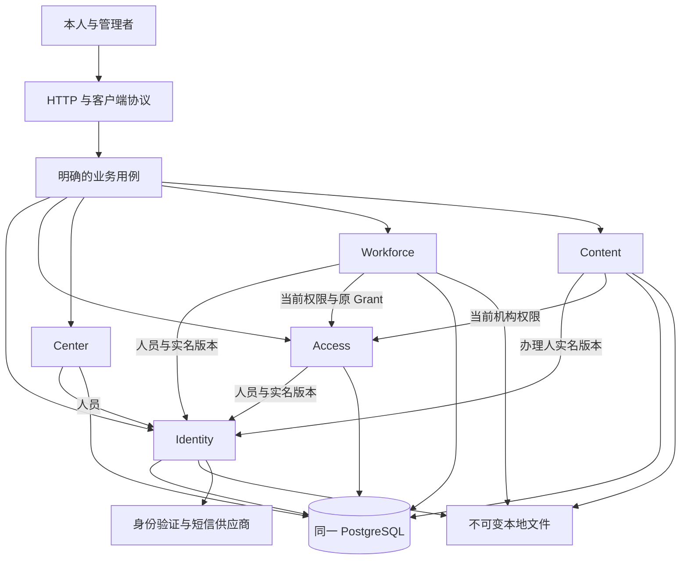
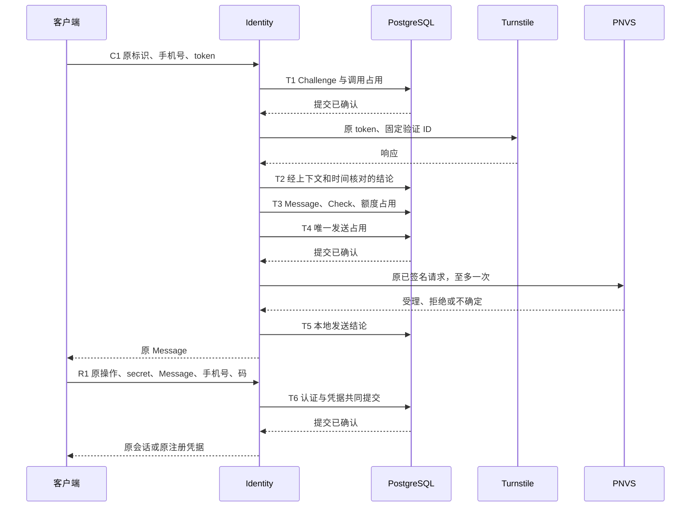

# Nucleus 架构

状态：当前目标架构，尚未完整实施。本文拥有能力与事实边界、共同事务、执行寿命、恢复、[应用内核](#应用内核)、[状态封印与威胁模型](#状态历史与完整性)、文件后果协调、类型和 crate 组织。各业务专题拥有办理条件、输入、状态、永久事实及响应细则。[文档导航](README.md)记录实际交付状态，[交付顺序](engineering/delivery.md)规定设计与实施边界。标明“当前”的内容描述已交付行为；标明“目标”的内容尚未实施，随所属切片交付后改写。

## 业务范围与事实所有权

业务后端只运行一个应用实例、一个应用进程，使用一个 PostgreSQL 和本地持久文件；目标由[数据库实例锁](#实例锁)强制单实例。网站独立构建和托管，交付归属见[网站与后端边界](http/site.md#托管与路由归属)。并发请求、后台工作、普通重启、响应丢失、提交未知，以及文件发布和清理中断属于运行范围。旧系统兼容、数据迁移、共存、切换、文件丢失、备份、灾难恢复和 Schedule 均不属于本轮范围。

| 能力      | 解决的问题                             | 拥有的事实                                                              | 主要消费者                               |
| --------- | -------------------------------------- | ----------------------------------------------------------------------- | ---------------------------------------- |
| Identity  | 人是谁、当前账户是谁、怎样证明本次身份 | Person、实名 Revision、Account、认证、Session、绑定、头像和账户生命周期 | 本人入口、全部当前资格检查、永久历史引用 |
| Access    | 谁能办理什么、谁参与 Workforce         | 权限目录、角色定义、指派、Grant、暂停恢复、结束和邀请                   | 管理办理、领域准入、工号和工牌           |
| Center    | 人员政治面貌档案                       | 首次填写、更正及永久取值历史                                            | 本人和有权管理读取                       |
| Workforce | 工号与工牌办理                         | 工号、目录、模板、照片、申请、固定提交、审批、Render、Badge、Delivery   | 本人、审批者、制作及发放人员             |
| Content   | 网站公开什么、何时由谁上线             | 栏目、文章、首页编排、内容图片、草稿、永久版本与上线事件                | 网站管理页、站点服务端渲染的匿名读取     |
| Platform  | 提供受控技术操作                       | 连接、密码算法和文件操作本身，不拥有业务结论                            | 业务库与两个入口                         |
| 入口      | 装配能力并处理运行边界                 | 环境和文件来源、HTTP 适配、进程生命周期、部署命令                       | 在线服务和停机运维                       |



Person 是永久人员身份，Account 是当前登录占用，Grant 是一次领域参与。注销释放账户占用，保留原人员与历史；同号码重新注册建立新 Person。结束后重新加入建立新 Grant。相同自然人、手机号或证件号不自动转移历史和资格。

账户可登录、领域可参与、管理者可办理分别判断。权限与等级共同约束办理；机构等级与 Workforce 等级不互相比较。恢复账户不恢复旧会话，恢复 Grant 不建立新授权。工号不随账户注销或 Grant 结束自动释放。

Submission 固定人工确认内容，Badge 表示已经接纳的永久成品，Delivery 表示成功保存的实际发放。三者不能相互代替。本人历史不返回办理人身份；管理读取按当前权限裁剪。永久保存不授予永久读取权。

当前没有机构业务档案期限。实名版本与更正、注销、角色和授权变化、邀请码接纳、政治面貌、工号、工牌申请结果、成品与发放按所属规则永久保留。属于本人且本人可见的内容不按年龄自动删除。技术清理不能缩短业务保留期；制定档案期限须先修改所属业务规则。

原操作者失权或注销不改写旧事实。有权管理者按当前资格读取；曾经经办、过去有权或持有相同证件号码不产生当前读取权。本人投影保留本人事实与生效时间，隐藏办理人身份；不因技术归档改变人员归属。

具体规则见 [Identity](identity/person.md)、[Access](access/grants.md)、[Center](center/affiliation.md) 、[Workforce](workforce/applications.md) 及 [Content](content/publication.md)。[业务总览](overview.md)提供办理路径。

## 用例与事务边界

用例拥有事务开始、提交和结局处理。[用例执行器](#用例执行器)统一实现这些步骤，用例以命令声明授权、锁、决定性事实、纯判断和原结果重放。当前消费者包括 Workforce 目录配置、Center 政治面貌、两组角色、机构与领域指派、Grant 准入及生命周期、邀请码、工号、初始化、账户暂停恢复、退出、换号完成、在线实名更正和本人及管理注销。其余用例仍各自实现。参与能力接收同一个事务，完成所属查询、判断与写入。能力不得独立提交半份共同结果。已迁入的状态变化与其变更记录、完成记录在同一事务写入。固定查询不外呼、不重试、不记录最终失败。

固定查询区分可靠缺席与查询失败。必有事实缺失属于依赖或完整性故障；异常存储事实不得伪装成输入错误、错误凭据或确定业务拒绝。HTTP 适配和后台入口都不能绕过所属用例的当前权限、事实与原操作检查。

| 用例                 | 同一事务必须成立的事实                                                                             | 分阶段部分                                            |
| -------------------- | -------------------------------------------------------------------------------------------------- | ----------------------------------------------------- |
| C1 发码              | 每个阶段的原证明、调用占用、结论或 Message/Check 配对                                              | 校验、发送许可、发送占用、供应商结果分别推进          |
| R1 认证              | 原证明与输入、认证结论、计错或消费、会话交接或注册凭据                                             | 无外呼，采用单事务                                    |
| R2 注册              | 人员、实名首版、账户、号码占用、默认头像关系、默认机构指派、会话、凭据消费和完成                   | 默认头像使用已核验的发布资源                          |
| 邀请接纳             | 当前准入、容量、Acceptance、Grant、首条指派及当前关系                                              | 无异步补建授权                                        |
| 暂停、换号           | 本次事实、当前状态变化、当次会话撤销及交接材料移除                                                 | 前置发码分别遵守 C1                                   |
| 注销                 | Cancellation、Account 与 Holder 墓碑、访问材料及当前角色移除、授权结束后果、无保护照片进入删除状态 | 外呼和文件收尾在事务外                                |
| 实名更正             | 新 Revision、更正事实、当前指针、当前证件占用                                                      | 不改旧申请和其他能力事实                              |
| 工号更正、撤销或恢复 | 涉及的一人或两人的历史、当前指针与号码占用                                                         | 不分段释放和重新分配                                  |
| 批准申请             | Review、approved 阶段、首个 active Render                                                          | 后台排版和计算                                        |
| 成品接纳             | Badge、Layout、Render.successful、永久材料保护                                                     | 候选文件先持久发布                                    |
| 实际发放             | Delivery、Application.completed、原 Grant 内发放序号                                               | 实体制作在事务外                                      |
| 内容发布、撤回或恢复 | 版本与图片引用（仅发布）、上线事件、当前上线指针                                                   | 图片上传处理在事务外，见[内容图片](content/images.md) |

外部调用、图像计算、完整文件传输和人工等待不占业务事务。结果接纳重新检查当前身份、原来源、版本和资格。原操作成功的回读不重复执行共同后果。

### C1 与 R1

C1 的原身份由 Challenge 拥有。客户端在首次发送前保存原 Operation-Id、手机号和原 token。widget 重置只影响下一次校验，不替换原材料。供应商 token 过期也不撤销已形成的本地事实。



各阶段的业务字段、期限、额度和继续条件由[短信认证](identity/authentication.md)拥有。发送工作独占其执行资格；重复 HTTP 请求只有核验和读取资格。Turnstile 重试沿用原验证 ID、次数和截止。不同原操作复用同一 token，由本地跨保留密钥版本的占用检查拒绝。

Message 许可提交后即消耗额度，并决定最新验证码。原发送工作只在发送占用提交已确认后调用 PNVS。供应商 OutId 仅用于关联，不能承担防重。已验证的请求直接发送，不重新编码或重签。

验证码只在原工作内短暂保留，数据库保存 Check HMAC。新进程不补发，因此数据库不保存验证码密文。许可存在但没有发送占用，旧工作结束后归为 failed；存在发送占用而可信结果丢失，归为 unknown。两者均不返还额度。

R1 在一笔事务中判断 Check。无效消息不计错；有效码的错误猜测计错一次并保存原拒绝。正确码被消费后，正常账户得到会话，暂停账户得到拒绝，无账户得到注册凭据。原结果重放不重新计错、签发或续期。

### 注册

注册用例从可信注册凭据取得手机号、实际应用来源和传递方式。输入只提供原操作、凭据证明和实名。原结果匹配先于新办理资格判断。

事务锁定原操作、注册凭据和号码占用，锁后重查期限、额度及唯一性。Identity 建立人员、实名和账户，Access 建立默认机构指派，再保存会话、交接、凭据消费和完成。任一步失败整笔回滚。不同手机号争用同一身份证号时，只允许一笔注册成功。

首次管理员由[停机初始化](operations/access.md)在空业务库共同建立人员、账户、系统角色和初始指派。初始化不签发在线会话，管理员通过正常认证进入服务。

### 注销与晚到结果

注销的[业务后果](identity/cancellation.md)在一笔事务成立。事务不等待正在外呼的供应商。相关工作在接纳时重新核对原人员、原账户、原会话或绑定修订；注销先提交时，晚到结果不得建立绑定、会话或账户。

协议占用独立承担防重责任，不能随当前账户级联消失。历史捕获的账户或会话标识只用于原身份比较，不表示当前关系存在。注销移除能够恢复旧账户访问的材料，保留必要协议父事实、占用和计数。

已进入数据库的冲突写入按共同锁顺序裁决。文件和计算工作只有真正结束后才能释放相关资源；注销不等待这些工作完成业务成功，也不直接删除仍被使用的候选文件。

## 并发协调

### 锁与决定性读取

每笔写事务使用 READ COMMITTED，依次取得运行共享屏障、原操作锁、权限范围保护及业务对象锁。原操作锁必须先收到成功确认，随后才发送任何业务修改；禁止把取得锁和修改流水发送。锁等待结束后，用新的语句读取决定性事实。

业务对象顺序固定为：外部 token/code 占用；人员和账户；手机号与身份证号占用；来源与部署额度；会话、Message/Check 和注册凭据；Grant；号码池和工号；配置、申请和资源。同类多个对象按规范键排序。权限范围保护按固定 scope 顺序排在这些对象之前。不涉及的锁跳过。初次查询只提供定位线索；锁后发现集合变化，回滚后以完整集合有限重试。

已有行使用与修改相冲突的行锁。尚不存在的号码占用、原操作或 token 使用事务级 advisory lock。稳定对象键不依赖活动密钥；哈希碰撞只增加等待，完整输入仍另行核对。唯一约束是占用的最终保护。

目标中业务对象锁就是[状态行](#状态模型)：运行身份直接对已有状态行取 `FOR UPDATE` 或 `FOR SHARE`，尚不存在的对象使用事务级 advisory 对象锁。当前经 `SECURITY DEFINER` 锁函数取得的行锁随之改为直接加锁；其他能力为推进个人顺序而取得的人员锁随个人顺序删除。内核的 `Locks` 按上述全局顺序排序并取得锁，执行器在锁后用新语句读取决定性事实。

机构与 Workforce 各有权限定义保护。用权及指派取得共享保护，修改角色定义取得独占保护，再重新读取当前持有人与等级。普通用权可以并行，角色定义修改不会穿过旧权限检查。账户或 Grant 的资格读取使用共享行锁，改变状态使用排他行锁；同一对象的独立读取不机械串行。

死锁或序列化冲突只在确认原事务结束后有限重试完整本地事务。未知提交先恢复；任何自动重试都不能再次调用已经占用的外部动作。实际锁集合与预算随各切片验证，不由包名推断独立性。

### 进程内工作与容量

普通查询、输入解析和纯预检查随 HTTP 请求直接执行。写用例在进入事务前取得有界工作名额，交给运行设施持有执行寿命。HTTP 只等待结果；等待取消不取消已经接纳的工作。即使单条本地写入也可能在提交后丢失响应，因此写入统一保留可观察的执行结束边界。代价是一次任务交接和有界登记；用例函数仍直接推进事务。

工作登记按能力、动作家族和原操作定位。同一原操作只有一个执行者。每个等待者分别核验原证明和输入，不能仅凭 Operation-Id 得到进度。工作登记保存句柄和必要上下文，不作为持久业务证明。名额耗尽的公开结果见[错误模型](#错误模型)。

| 组件                   | 实际消费者                     | 必要性                             |
| ---------------------- | ------------------------------ | ---------------------------------- |
| 原操作登记             | 写用例、重复请求、恢复者       | 保持唯一执行者，避免第二个外呼工作 |
| 任务句柄集合           | 停止、panic 和异常收尾         | 给出实际执行结束边界               |
| 有界许可               | 数据库办理、供应商、图像和传输 | 限制真实资源占用，超时不提前归还   |
| 独立恢复连接           | 未知提交、启动核验             | 普通池耗尽时仍能核对               |
| active Render 查询     | 工牌后台执行                   | 已批准工作不依赖客户端再次访问     |
| 所属发布意图与删除状态 | 文件恢复和清理                 | 发现已承诺的文件后果               |

运行设施不解释验证码、角色或申请状态，不保存通用 job 或通用执行表。未迁入的用例仍直接承担阶段分支和错误处理，共享连接结局、工作寿命、容量和停止原语。[用例执行器](#用例执行器)只实现一次原操作识别、恢复、判定顺序和错误分类，当前消费者见[应用内核](#应用内核)。命令是有业务含义的类型化声明，不是通用命令表或任意回调。

每种外呼、图像和传输许可由消费能力定义。没有许可时拒绝或按所属有界等待预算处理，不建立无限队列。阻塞计算持有许可直到实际退出；取消信号和等待超时不能提前释放许可。

## 原操作与恢复

### 原操作识别与保留

每个动作家族拥有原标识、封闭 action、规范输入及证明规则。原标识定位办理，不授予认证或历史读取权。先核对原证明，再比较原输入，最后决定本次可交付结果。同键异 action、目标、版本或规范输入返回 request_mismatch。

当前永久业务事实直接保存 Operation-Id，需要时另存原输入证明，不复制通用成功回执；可变配置的完成定位由[配置原请求](workforce/completions.md)拥有。目标中每次写入另在所属能力的[完成记录](#完成记录)保存一行，原操作识别与异输入判断都经完成记录。业务记录仍保存 Operation-Id，供按原操作取回原记录。需要固定重放的拒绝由所属用例声明，例如验证码错误；格式、认证、权限和依赖错误不自动变成永久业务历史。

短期结果仅在所属保留期内承担原操作识别。期限覆盖原结果恢复、防重、额度统计和真实引用。责任结束后删除完整记录，不另建永久标识集合。已有永久业务事实仍按所属业务期限保留，其中的 Operation-Id 继续定位原完成。

UUID 不提供可信接纳时间。记录清理后，服务无法区分旧标识与首次使用的标识，不再保证返回原结果或固定的过期响应。此时请求重新满足所属用例的新办理条件；旧标识不授予资格。客户端在恢复期限内使用原材料，期满停止自动重试。跨表动作家族在原操作锁下检查保留的封闭成员，以固定约束保护唯一性。清理与办理采用相同原操作协调。

### 未知提交

HTTP 等待失败、供应商结果未知和数据库提交未知分别处理。连接异常不证明回滚，业务事务回滚也不证明外部动作没有发生。

1. 原工作停止推进后续阶段，保留原操作归属及相关候选资源。
2. 将原连接移出池，停止并等待驱动结束；不把有疑义的连接交给其他请求。
3. 独立恢复连接取得同一原操作事务锁，等待可能仍在运行的旧事务结束。
4. 锁后用新语句读取本阶段的持久完成及必要配对事实。
5. 所有者解释原成功、确定未提交或仍然未知，再决定允许的后续动作。

第一笔事务在修改前已确认取得原操作锁。恢复期间原工作不能再发新命令，同操作也不能另起写者。若原锁未取得，协议保证尚未发送修改。驱动结束不单独证明 PostgreSQL 后端结束，恢复锁提供数据库边界。

[内核事务边界](../domain/src/kernel/tx.rs)统一处理结果与收尾，`database::transaction` 为现有消费者保留兼容入口。用例区分已完整核对的原结果和本次待提交候选。共享提交处理只在 COMMIT 确认后提升待提交候选。失败时保留候选及原因，交回所属用例恢复。已知结果不因后续只读事务或连接收尾失败而丢失。首次读取原结果和失败后的回读遵守同一规则。

已知业务结果由 Domain 内的所属用例判断；部署入口只接续该判断的事务收尾，不能自行构造已知原结果。

事务结束使用所属用例给出的绝对截止。原结果读取与只读 COMMIT 共用事务预算；拒绝后的独立回滚沿用所属协议的有界预算。独立会话等待驱动结束；在线连接只在事务结束确认后归池，否则淘汰并等待驱动。收尾保留实际查询、超时及连接错误，不提前释放所保护的工作。已知阶段本身不授予后续外呼或交付资格，相关判断及最终诊断仍归用例。

已提交事实允许后续合法办理改变当前状态。因此恢复核对原完成，不要求全部当前指针还保持原成功时的值。后续修改和清理不得抹去仍承担恢复责任的证据。删除恢复绑定实际尝试删除的实体身份及记录组，先结束旧连接，再跨原操作锁核对整组是否仍在。原组全部删除才确认删除完成；同一 Operation-Id 下的新实体不属于原删除。其他删除后果仍使用所属删除意图，不能用一次查无记录推断业务回滚。

已接纳写入的内部恢复沿用首次修改前核验的办理人员，完整比较原输入与永久事实。后来会话撤销或办理人失权，不撤销原办理的完成依据，也不触发再次写入。该绑定只由原工作保留；新的请求仍重新核验当前身份和所属权限。交付新的凭据或继续外部动作所需的资格，仍按所属阶段规则判断，不能由永久业务结果的核对代替。

未知范围默认限定在原操作。其他事务通过业务对象锁等待数据库实际结局，并在新语句中读取当前事实。数据库或密钥整体不可用时停止依赖能力；事实矛盾或执行归属丢失时关闭受影响写入。无法界定影响范围时结束进程，不继续宣称可靠服务。

运行中单笔未知提交不排空所有 Identity 工作。启动和停机维护仍使用独占运行屏障，等待旧共享屏障事务结束。恢复连接断开后重新取得适用锁，不能沿用上一条连接的证明。

这一协议在[用例执行器](#用例执行器)只实现一次，事务与收尾由 `kernel::tx` 承担。Workforce 目录配置、Center 政治面貌及两组角色维护已迁入。其余用例沿用自身恢复编排和同一组事务原语。恢复连接取得同一原操作锁后按完成记录核对，得到原结果、确认未提交或仍然未知。Center 与角色的待定状态由[锚定](#锚定)保留。之后取得对象锁的写入者也能按原值或候选解决。单笔未知提交不排空其他工作。写入候选未结算就被丢弃时关闭接纳，与异常遗弃规则一致。

### 清理

到期只产生清理候选。清理者取得原操作与对象协调，核对执行已结束、阶段可解释、恢复期限、统计窗口、真实引用和外部占用责任。未知、在途或矛盾对象保留，不能因年龄推断孤立。

每笔删除事务也有明确结果依据。批次标识不代替被删除对象的原操作。技术清理不删除永久历史，不返还邀请累计容量，不使原 code 再次可交换。文件删除遵守下一节协议。

当前各能力分别维护清理游标与删除事务，配置完成记录的清理由 `kernel::completion::Retention` 承担。目标中每种短期记录以内核的 `Expiry` 声明候选列举、按原操作锁删除和结局核对，由同一个后台循环调用；C1、R2、换号、配置完成与会话共用。

## 应用内核

当前内核运行 Workforce 目录配置、Center 政治面貌、两组角色、机构与领域指派、Grant 准入及生命周期、账户暂停恢复、退出、换号、在线实名更正、系统管理员实名更正和本人及管理注销完成。邀请接纳使用准入完成家族。停机初始化、指派、实名更正与政治面貌更正也使用同一执行器。Center、角色、Holder、Grant、Account 和 Session 接入 `domain::history` 的状态、记录、锚定和启动扫描。上述命令共用封装后的完成记录。Account、角色、Holder 和 Grant 的终态保留永久墓碑；Session 与所属记录按短期完整组删除。用权鉴别所属 Holder 或 Grant 及 Role 状态，会话主体鉴别 Session 和 Account。历史读取鉴别实际所需的永久记录。其余组成继续按[架构内核与状态封印](engineering/delivery.md#架构内核与状态封印)逐片迁入。

应用内核统一写用例的共同流程：唯一执行者、有界名额、原操作识别、未知提交恢复与写入判定顺序。错误分类与 HTTP 映射也只有一个实现。目标中内核与[状态历史模块](#状态历史模块)不依赖业务能力，最底层密钥、操作与错误原语只依赖 platform。执行器、事务、完成记录与启动装配依赖状态历史模块；history 只依赖底层原语，不依赖执行器或启动，也不拥有业务规则。迁入的能力声明状态与记录种类、纯迁移、已核验加载器，以及命令与查询。当前授权助手仍保留下述过渡依赖。

### 内核组成

| 模块                 | 职责                                                                  |
| -------------------- | --------------------------------------------------------------------- |
| `kernel::executor`   | `Command`、`Query` 声明，`App::command`、`App::query`，写入管线与恢复 |
| `kernel::operation`  | `Family` 唯一词汇、`operation::Id` 与请求规范输入                     |
| `kernel::completion` | 各能力 `<schema>.completions` 的模板种类                              |
| `kernel::tx`         | 共同事务、连接寿命与收尾；目标中的 `Locks` 统一全局锁序               |
| `kernel::time`       | 事务内时间观察与进程内高水位                                          |
| `kernel::keys`       | 当前提供状态记录与完成输入的信封；其余统一密钥能力仍属目标            |
| `kernel::error`      | `Error<R>`、`Fault`、`FaultKind` 与 `Rejection`                       |
| `kernel::startup`    | 目标模块：[实例锁](#实例锁)、前置核验、状态历史核验与构造 `App`       |
| `kernel::retention`  | 目标模块：`Expiry` 与单一清理循环                                     |

`Family` 是登记表、原操作锁键、完成记录命名空间与日志标签共用的唯一词汇。家族命名空间显式表达共用的原操作唯一性，例如邀请接纳与准入共用 Grant 家族，在线更正与系统更正共用更正原操作锁。当前 `runtime::registry::Family` 以 `Kernel` 变体收纳目录配置、Center、两组角色、机构与领域指派、Grant 准入及生命周期、初始化、账户暂停恢复、退出、换号完成、两类实名更正及注销家族。其余家族随迁入统一。当前写事务 10 秒、读取 3 秒与 HTTP 等待 30 秒分别由执行器、读取预算和路由助手执行。统一内核设置仍属目标。

目标主体分为会话主体、系统主体、引导主体与匿名来源。系统主体是停机运维的操作者，引导主体只用于空库初始化。当前会话命令声明原 Session。命令取锁后，执行器用同一决定性时间鉴别 Session、Account 与 Person，再交给用例判断权限。会话命令先授权再查原结果；系统指派与引导初始化先查原结果，再由用例判断新办理资格。匹配原完成后，重放保留原人员与实名版本。匿名主体仍随消费者迁入。

当前 `Command` 声明 `COMPLETIONS`、`ORDER`、`session`、`request`、`locks`、`authorize`、`load`、纯 `decide`、`apply` 与 `replay`，由 `App::command` 执行。`session` 提供原会话主体；执行器鉴别后把主体传给 `authorize`，由后者判断权限并返回人员、实名版本和决定性时间组成的 `Authorization`。`request` 构造封闭动作、规范目标与输入。`load` 接收已授权主体。`apply` 返回输出，并把已写状态的候选交给执行器持有；后续写入失败也不会丢失已登记的候选。初始化的角色、Account 与 Holder 共用一组 `Pending`，按同一提交结局结算。目录配置没有状态锚定候选。`Query` 以关联类型 `Authorized` 把授权结果交给 `read`，同时传入 `history::View`。

`Tx::begin` 承担 READ COMMITTED、截止、共享屏障、代次栅栏与原操作锁。C1 Challenge 的首次接纳、阶段更新与原操作回读通过 `Tx::begin_operation` 使用同一实现，保持原 `challenge/operation` 锁域，不建立完成记录家族。未迁入的用例经 `database::transaction` 调用同一底层实现。`Tx::now` 在锁后通过当前事务取数据库时间，与进程内高水位比较并推进高水位。命令按全局顺序自行取锁，通用 `Locks` 仍属目标。写入发现锁后集合变化时，执行器先回滚，再在原截止内完整重试一次。`ORDER` 由系统指派和初始化消费；会话主体由执行器统一解析。`FaultKind` 暂含 Identity 与 Access 的过渡错误类型。

`kernel::keys` 当前管理信封的活动及保留 `encryption` 密钥版本。Identity 的个人数据、Center 取值及共同完成输入复用这一实现。各记录所有者继续提供原字段绑定，密文字节契约保持不变。封印仍复用 `keys::seal`。`kernel::startup`、`kernel::retention` 和通用 `Expiry` 尚未建立，当前启动装配与配置清理继续使用现有入口。

### 用例执行器

下表及写入管线描述完整目标接口。当前会话主体解析和锁集合变化的完整重试已由执行器承担。换号完成把错码计数与原拒绝共同提交并固定重放；R1 等分阶段协议继续使用所属实现，匿名主体仍随消费者交付。

| 声明                  | 含义                                                           |
| --------------------- | -------------------------------------------------------------- |
| `FAMILY`              | 动作家族                                                       |
| `ORDER`               | 先授权或先查原结果                                             |
| `Input`               | 规范输入，参与请求封装与异输入比较                             |
| `Output`、`Rejection` | 成功结果与封闭业务拒绝；拒绝自带状态码与应用码                 |
| `locks`               | 本命令需要的锁集合                                             |
| `authorize`           | 在本事务内由主体与当前状态得出权限                             |
| `load`                | 只经所属加载器取得已核验的决定性事实                           |
| `decide`              | 纯函数：由主体、输入、事实与事务时间得出变更与结果，或业务拒绝 |
| `replay`              | 只读原记录与完成记录，重建原结果，不读当前状态                 |

`decide` 不访问数据库、时钟或供应商，可以脱离数据库测试。它返回应用的变更与结果，或返回拒绝。需要固定重放的拒绝（例如 R1 错码）也随变更与完成记录提交，其余拒绝回滚。写入管线只在执行器实现一次：

```text
接纳检查：关闭即拒
request = 封装(家族, 原操作, 主体, 规范输入)
Work 登记：唯一执行者、有界名额、脱离 HTTP 等待
  Tx::begin：READ COMMITTED、截止、共享屏障、原操作锁（确认取得后才写）
  按全局锁序取得主体对象与 locks 声明的锁
  now：锁后新语句的数据库时间，与进程高水位比较；同一观察贯穿主体、授权与决策
  主体：锁后核验 Session、Account、Person，会话期限按 now 判断，失败 401
  authorize：失败 403
  原完成：按家族与原操作查找完成记录
    命中：请求相同则 replay 交付已知结果，否则 409 request_mismatch
  load：锁后新语句读取决定性事实；锁后集合变化则回滚并以完整集合有限重试
  decide：
    拒绝            → 回滚 → 业务拒绝
    需固定重放的拒绝 → 写入变更与完成记录 → 提交 → 业务拒绝
    应用            → 写入变更与完成记录 → 在锚定中登记待定候选 → 提交
      确认提交 → 结算锚定 → 已知结果
      提交未知 → 淘汰连接并等待驱动 → 恢复连接取得同一原操作锁，按完成记录核对
               → 已知结果、确认未提交，或仍未知并保持存疑
```

上图是会话主体的顺序，与 [Access 管理写入](access/http.md)规定的判定顺序一致，各能力不再各写一份。系统主体的原完成读取紧接原操作锁之后。命中后核验可信时间与输入，再交付原结果，不再取得业务对象锁或重新授权。内部恢复也先读取原完成；缺席即确认未提交，命中才核验记录时间并回读结果。这满足停机运维“取锁后第一条决定性读取是原事实”的要求。写入候选未结算就被丢弃时关闭接纳。

分阶段外呼流程不套用单事务命令，例如 C1 发码、R1、R2，以及以后的微信与文件发布。它们由同一组原语 `Tx`、完成记录、恢复与 Work 组成，至多一次外呼的规则不变。

读取以 `Query` 声明 `authorize` 与 `read`。执行器检查接纳，先取锚定视图，再开始 3 秒 REPEATABLE READ 只读快照。主体、权限、计数与本页在同一快照内取得，提交后分类结果。锚定在视图之后变化而产生 `Changed` 时，读取回滚并用新视图完整重做一次身份、授权与读取。重试与只读 COMMIT 共用原截止。读取不进入 Work 或原操作恢复。

查询的决定性时间在同一只读快照内观察并核验，快照结束后直接交付原结果。

### 完成记录

Center、角色、机构指派、初始化、账户暂停恢复、退出、换号完成、在线实名更正、工号办理与 Workforce 配置写入均追加完成记录。业务变化与完成记录在同一事务提交。共享记录固定家族、原操作、动作、目标与封装后的规范输入，也保存主体、完成时间、保留期限与封印。当前会话、系统与引导主体均固定人员及实名版本，连同主体标签进入 AAD 和封印。Workforce 配置完成至少保留 24 小时，换号错码拒绝保留到原确认期限后 24 小时；其余已迁入的成功完成永久保留。业务记录仍保存 Operation-Id，用于回读原结果。

`kernel::completion` 负责这些完成的查找、输入比较、追加和分批启动核验，也负责 Workforce 的过期清理。`completion::Template` 绑定家族、动作与目标配对规则，以及是否只允许原人员重放。个人模板先比较存储的人员 ID，不符即拒绝，不解封原输入。这个比较只用于拒绝，不证明记录可信；人员匹配后仍须解封输入并核对完整封印。Center 与角色随后比较规范输入，再由所属 `replay` 回读原结果。角色的 `institution_role` 与 `workforce_role` 家族共用 `access.completions`，各自永久绑定原操作。目录使用配置模板，沿[配置重放规则](workforce/completions.md#重放与条件写入)允许其他当前有权者重放。内核不解释业务状态，由能力的 `replay` 交付原结果。

目标中其余能力按同一模板迁入各 schema 的完成记录，取代各自的输入证明和停机计划绑定。当前初始化、停机指派及系统管理员实名更正已删除独立计划绑定表。引导主体固定建立的首个身份，规范输入保存引导材料；系统主体固定当次操作者。匿名主体及 Identity 的其余完成仍随消费者交付，Content 随首个消费者建立。C1 的 Challenge 与 Message 证明保留。

`expires_at` 为空表示永久；Workforce 配置固定为完成后 24 小时，换号错码拒绝另按所属确认保留。规范输入沿用无空白 JSON，以 `encryption` 派生键做 AEAD。AAD 绑定家族、原操作与带标签的主体。解封后核对覆盖规范明文及记录身份的单行封印，再逐字节比较输入。字段顺序与冻结编码由所属代码及独立测试向量维护。重新封装密文不改变明文封印，完整换钥工具仍属后续交付。完成记录在启动、重放及清理取用时核验，不进入状态锚定。删除完成记录的残余风险见[威胁模型](#威胁模型)。

迁入完成记录之前，现有输入证明继续以 HMAC 保存。证明绑定的每个字段都必须能从保留的事实还原；需要保密而不保存原文的输入，保存所属用途密钥的摘要并让证明绑定该摘要。工号已迁入完成记录，保留完整规范输入及其封印。

### 错误模型

命令与查询返回 `Error<R>`，`R` 是该命令的封闭拒绝：

| 变体                 | 含义                       | HTTP                                   |
| -------------------- | -------------------------- | -------------------------------------- |
| `Rejected(R)`        | 已确定的业务拒绝           | 由 `R` 给出状态码与应用码              |
| `Unauthenticated`    | 主体不成立                 | `401 authentication_invalid`           |
| `Denied`             | 没有该动作或对象的权限     | `403 permission_denied`                |
| `Mismatch`           | 同一原操作的请求不同       | `409 request_mismatch`                 |
| `Busy`               | 工作名额耗尽               | `429 rate_limited`，附 `Retry-After`   |
| `Unavailable(Fault)` | 依赖或必要事实无法可靠取得 | `503 dependency_unavailable`           |
| `Unknown(Fault)`     | 提交结局尚未确认           | `503 outcome_unknown`                  |
| `Corrupt(Fault)`     | 存储事实损坏               | `503 dependency_unavailable`，关闭接纳 |

`Fault` 保存安全的阶段、封闭的 `FaultKind`（查询、解码、连接、超时、密码或违反的完整性规则）以及收尾或恢复中另外发生的失败；每项保留真实类型。各模块不再重复组合、回滚、未提交与观察失败变体。`Corrupt` 在发现处构造，执行器统一关闭接纳。HTTP 只有一处把 `Error<R>` 映射为响应，通用码沿用 [HTTP 应用码](http/api.md#json-结果与应用码)，每个能力只定义自己的拒绝及其状态码与应用码。写入的最终失败在执行器记录一次，读取在路由适配记录一次。授权助手返回内核错误类型，Identity 不再经错误类型依赖 Access。

已接纳的工作没有交付结果就结束时（任务异常退出），执行器关闭接纳并返回 `Unknown`。已确定的拒绝之后回滚失败时，仍交付原拒绝及其状态码与应用码。该路径未发送 COMMIT；失败连接被淘汰并等待驱动结束。已有写入候选在确认回滚后撤销；回滚未确认时保留存疑状态，由后续持锁读取解决。驱动结束不单独证明数据库事务已结束。执行器将拒绝码与回滚故障一并记录一次，不改报 503。HTTP 的唯一映射位于 `src/route.rs`。工作名额耗尽统一为 `429 rate_limited`。当前已迁入内核的 Access、Workforce、Center 及上述 Identity 命令如此返回；实名更正与注销仍返回 `503 dependency_unavailable`，迁入执行器时改为 429。

## 文件与数据库后果

### 发布与接纳

每个资源所有者保存自己的 SQL 发布意图。头像意图绑定账户原修订，Badge 意图绑定 Render 和执行代次；共同字段包括原操作、候选 ID、执行身份及恢复所需元数据。意图不接收任意任务类型、JSON 工作流或客户端路径。

1. 取得所属工作许可，确定执行代次与候选资源 ID。
2. 保存发布意图并确认提交，之后才创建受恢复保护的候选文件。
3. 在事务外解码、排版、编码和封装。记录完整输出身份，完成文件同步。
4. 同卷、不覆盖地发布候选，再同步受影响目录。已有路径只在原候选身份完全匹配时复用。
5. 在短事务中重新检查原执行、当前资格、期望版本和真实引用，保存资源、原完成和保护，并标记采用。
6. 确认提交后收尾；只有旧工作结束且原候选确认未采用，才能删除候选。

已接纳业务资源只引用完成持久发布的文件。文件设施不创建 pending Badge，也不在数据库成功后异步补字节。数据库提交未知时保留候选与意图，按原操作恢复。

| 恢复状态                 | 后续动作                         |
| ------------------------ | -------------------------------- |
| 意图存在，候选未完整发布 | 原工作结束后按所属规则继续或清理 |
| 候选已发布，尚未接纳     | 核对原完成和当前接纳条件         |
| 接纳提交未知             | 保留候选，等待原操作核对         |
| 接纳已成功，收尾未完成   | 保留采用文件，完成意图收尾       |
| 候选未采用且原工作结束   | 清理准确候选，不碰其他身份       |
| 文件身份与意图矛盾       | 完整性故障，停止相关接纳         |

Render 的批准事实、尝试编号和执行代次分别表达业务授权与技术执行。重启可继续原 active 尝试；确需重新计算时，先证明旧候选未采用，再分配新代次和新候选 ID。明确失败后的新业务尝试由管理者授权，后台不得自行增加。

### 删除与读取

资源所有者在短事务中重查引用，并保存 deleting，阻止新引用和新打开。确认提交后在事务外 unlink、同步目录，再保存 deleted。中断时按已保存状态继续。头像可在共同事务中删除所有者行并保存准确删除意图，再完成字节删除。

签名读取先验签，再在资源共享行锁保护下核对状态并打开准确常规文件。随后释放事务，持句柄完成有界读取、密码鉴别与发送。删除方取得冲突行锁后才能提交 deleting；已经打开的句柄可完成读取。候选文件由唯一工作和持久意图保护，无须全局路径锁。

资源身份、可信路径、密码封装、签名格式和各类保护期限由[本地文件](storage/files.md)及业务所有者定义。成功 Badge 永久保护成品、Layout、照片和模板效果，未发放也受保护。本人可见照片不按年龄自动删除。

### 文件换钥

停机维护先排空旧执行并越过独占屏障。所有者意图固定原、新版本和物理身份，准备并鉴别新封装，保留旧封装后原子替换正式路径，再提交新元数据。所有同步点遵守发布协议。

提交未知时保留两套封装和密钥。核对数据库与正式文件都指向新版本后才删除旧封装。未收尾换钥阻止依赖能力就绪；旧材料退役检查覆盖全部资源、意图和加密业务字段。

## 类型、构造与查询

输入结构拥有形状、必填项、缺省和未知字段处理。JSON 字段优先直接使用已有受控值类型，反序列化复用其构造或解析规则；输入组合另行调用所属构造器。值类型和实体拥有自身不变量，用例拥有当前资格及跨事实规则。字段保持私有，暴露范围按实际消费者决定。

```text
外部输入 → 形状检查 → 规范业务值 → 当前事实判断 → 写入 → 提交已知 → 响应
数据库行 → 结构与字段校验 → 存储事实 → 原证明/鉴别/当前资格 → 本次可用结果
```

| 类型边界                  | 受控构造                                         | 主要消费者               |
| ------------------------- | ------------------------------------------------ | ------------------------ |
| Mobile、IdNumber、Name    | 统一值解析；历史规则不混入新办理日期限制         | 输入、解密结果、占用计算 |
| 存储 Session 与 Actor     | Actor 经过秘密、来源、期限、撤销、账户与绑定核验 | HTTP 身份与用例复查      |
| token Proof 与匹配结果    | 按原密钥验证原材料                               | 原请求恢复               |
| Siteverify 响应与通过结果 | 供应商成功、上下文、时间全部成立                 | Message 许可             |
| 已验证请求                | 一次编码和签名后固定字节                         | 唯一供应商调用           |
| 发送占用与执行许可        | 已确认提交且仍由原工作持有                       | PNVS 外呼                |
| 原业务事实与成功响应      | 原证明、读取资格和已知提交                       | HTTP 投影                |
| 已核验状态                | 只由状态历史模块核对封印与锚定后构造             | 迁移函数与加载器         |

FromSql、Serde、Default、公开字段及转换不能绕过成功资格构造。数据库解码只证明存储表示合法；不能自动产生 Actor、供应商成功或发送许可。合法过期、撤销和结束历史仍可解码。已接入的受保护状态与记录只经[状态历史模块](#状态历史模块)解码，核验结果以 `Verified<T>` 交付；通用不可变取值种类仍属目标。

当前 Account、Session 与 Person 由所有者按主键或定位键加载，鉴别封印及锚定。手机号、证件号、人员及原认证等定位不能把裸 SQL 命中或缺席当作已核验结果。持锁读取复用既有排他或共享锁；只读页共用同一锚定视图和快照。当前账户查找过滤注销墓碑，永久人员读取仍鉴别 Account 墓碑。Person 状态固定当前实名版本，更正和注销保存所属记录；实名版本由不可变取值种类鉴别。读取当前实名时，以已鉴别 Account 核对当前证件号摘要。墓碑仍保留原人员资料。

只在实际误用边界分类型，不为每个内部步骤建立阶段包装。列表直接查询需要的投影，写入只读取决定性事实；不要求完整聚合加载、逐层 DTO 或异步查询副本。目标中业务决定只读状态行与不可变取值，不读变更记录的聚合；列表在状态行上筛选、排序与计数，历史页按对象内序号读取记录。当前权限查询与同页数据使用一个决定性快照。授权读取的 3 秒只读 RR 预算由 `domain::database::read::Budget` 统一拥有，随运行 `Context` 共享；本地截止与两个服务端超时取自同一时长。仅测试可在构造 `Context` 时覆盖预算。

错误保持安全的操作、类别、阶段和结构化原因。校验业务事实或可信时间时，错误说明所属检查及违反的规则，不回显异常值。当前复用已有变体和上下文，不为所有错误统一增加阶段字段；目标的技术失败统一为带阶段的 `Fault`，见[错误模型](#错误模型)。取列与业务值解码失败分别定位。仅按 SQLSTATE 和具名约束映射确定的业务冲突，其余作为技术故障。

错误诊断与日志不输出原始请求、手机号、秘密、验证码或 token。供应商原文和数据库 detail 同样禁止输出。脱敏覆盖 `Debug`、`Display`，以及来源链的格式化或日志输出。禁止直接记录未经脱敏的来源链。最终处理边界只记一次失败，保留上述定位信息。

受管写入的最终技术失败由工作完成边界记录，HTTP 等待者退出不转移这项责任。交付结果无人接收时仍保留安全诊断。请求解析和普通读取的技术失败归请求处理边界；进程启动与停止失败归进程入口。预期业务拒绝按所属协议返回。响应映射和错误转换不重复记录执行失败。

原始原因仅按所属契约保留，供受控检查。具体边界见[设置错误](settings.md)、[凭据装载](platform/credentials.md#装配与验收边界)和[数据库连接](database.md#已交付的连接库)。保留来源不代表允许输出原文。[PNVS 解码错误](platform/pnvs.md#单次-http-调用)沿用自身的安全诊断约定，不保留原始原因。

驱动执行、连接及取列等技术故障保留可安全检查的来源。取列后的值校验保留所属字段路径与原因。约束映射遵守 [SQL 失败边界](engineering/sql.md#database-failures)。错误转换只分类和传递。用例决定业务动作，事务边界核对提交。HTTP 边界映射稳定应用码。

## Crate 与模块组织

本节规定完整目标职责，并区分当前代码与目标布局。五个 package 已经建立，Identity 业务事实归 `domain::identity`。当前 `src/main.rs` 是可执行入口，`process` 持有应用生命周期。C1/R1 请求适配归 `src/identity/authentication/`，R2 适配归 `src/identity/registration.rs`；监听、路由、健康检查、请求标识、来源和共同响应已拆为根模块。其余业务能力仍随所属切片交付。

nucleus 提供后端业务入口与运行边界，不托管网站页面或构建资源。网站发布与后端启动分别验收，职责见[网站交付](http/site.md)。业务图片、字体与工牌读取仍归所属后端能力，其可信文件与签名规则不属于网站静态托管。

| Package    | 职责                                                                   | 依赖             |
| ---------- | ---------------------------------------------------------------------- | ---------------- |
| nucleus    | HTTP、来源与传输、输入读取、装配和进程生命周期                         | domain、platform |
| domain     | Identity、Access、Center、Workforce、Content；明确用例、查询和业务恢复 | platform         |
| platform   | 数据库连接、密码算法、可信文件操作、有界 IO                            | 已验证的技术库   |
| deployment | 迁移、空库初始化、密钥及停机维护                                       | domain、platform |
| fixture    | 隔离 PostgreSQL、虚构材料、供应商替身和故障注入                        | 仅测试使用       |

根 `Cargo.toml` 声明 nucleus 包及 workspace，根 `src/` 保存应用装配。业务库位于 `domain/src/`，platform、deployment 和 fixture 各在同名目录。五个业务能力同属 domain。模块维护事实所有权和受限可见性，不用独立 crate 强迫共同事务穿过公开存储接口。Identity 不向上依赖跨能力用例；已交付的 registration、suspension、correction、cancellation 分别组合各所有者。`domain::account` 组合精确账户候选、已知账户头像、协助换号建立与换号状态读取。事实仍归 Identity，权限及角色仍归 Access。其余用例随消费者接入。Platform 不保存业务权限或记录身份。

domain 已建立[应用内核](#应用内核) `domain::kernel` 与[状态历史模块](#状态历史模块) `domain::history`。当前消费者与其余目标边界见对应章节。目标中共享模块不依赖业务能力，状态历史模块使用底层内核原语。当前内核仍引用 `identity::operation::Id` 及会话、成员资格的错误类型，随所属切片移入内核。能力模块按种类与纯迁移、命令、查询及加载器组织；能力之间只经加载器与纯迁移函数往来，不直接查询或写入对方受保护的表。注册、注销、账户暂停与实名更正等跨能力命令放在主状态所属的能力内，根部编排模块与 identity 下的同名模块合并。仍保持一个 domain crate，因为 `Token` 与 `Verified` 的构造限制依赖 crate 内可见性；内核是否独立成 crate 按实际编译耗时判断。不引入 ORM、sqlx 编译期查询或事件溯源。

换号的当前资格由 `identity::transfer` 在调用方事务内核对，供协助建立、新号 C1 和完成共同使用。协助分支直接消费 Access 的权限及完整指派查询。Access 不回调认证或换号流程；Identity 不调用上层 `domain::account` 用例。这样各个 C1 阶段仍在自己的事务中复查资格，且继续使用原有供应商监督与恢复。

单一职责以事实、规则及变化原因为边界。同一不变量的判断由一个所有者维护。判断拆分时，先核对哪些规则必须一起改变。文件、函数和技术层次本身不决定职责。不要为缩短函数拆散完整规则。

从调用方必须理解的知识判断封装边界。调用方操作内部任务表，或逐层解开事务错误才能判断业务结果，都是职责可能外泄的信号。所属能力提供有业务含义的操作与结果，内部表示保持受限可见。

迁移职责时一并核对所属类型、错误、校验、可见性、测试与文档。只移动函数无法完成事实所有权的迁移。检查原调用方和新消费者，避免留下旁路或两套规则。

模块围绕明确职责组织。引入 trait 或包装时，说明实际消费者与保护的规则或约束。以调用方必须理解的概念与规则判断收益，并计入新增间接层和命名的成本。缩短函数、转发调用或增加目录本身不是抽象的依据。

通用能力的工具与库复用、自行实现及偏离库默认行为，遵守[工具选型](engineering/verification.md#工具选型)。

### 根包入口目标

根包 `src/` 直接按业务能力组织请求入口，共同协议与生命周期各有独立模块。下列树只列职责位置，省略 `mod.rs`。目录随真实消费者建立，设计认可不授权实施全部能力。

当前已建立树中的共同模块，Identity 的实际入口与预算见 [HTTP 入口](http/api.md)及实际 OpenAPI。Access 的机构角色、指派及读取入口位于 `src/access/mod.rs`，Workforce 自定义角色维护也由它适配同一 Role 服务。准入、暂停恢复、结束及本人领域读取位于 `src/access/grant.rs`。Center 填写、更正及读取位于 `src/center.rs`，Workforce 工号领取、管理办理与读取位于 `src/workforce.rs`，工牌入口尚未建立。`identity::settings` 拥有共用 Origin 设置校验；各入口输入只拥有正文结构及领域输入组合。共同中间件校验适用的操作标识，独立提取器取得来源与 JSON，处理函数组合领域输入。`identity::current` 的路由中间件只选择证明并取得受控 Actor，各领域用例在决定性读取时再次核验原会话。注销内部恢复如何核对已删除会话的原结果，由[注销恢复](identity/cancellation.md#失败重启与验收)规定。JSON 提取器委托 Axum 解析正文，连接寿命和图片传输许可归 `listener`。具体边界见 [HTTP 提取边界](http/api.md#提取与错误归属)。当前各用例的错误适配映射请求拒绝与业务错误；共同 `response` 只处理封套和响应头。`route` 统一完成命令与查询的等待和错误映射，当前由 Workforce 目录和 Center 入口使用；目标中能力入口只保留路由表与结果投影，提取也由 `route` 完成。

```text
src/
  main.rs
  lib.rs
  process/
  listener.rs
  router.rs
  diagnostics.rs
  health.rs
  operation.rs
  source.rs
  response.rs
  route.rs
  identity/
    authentication/
    admission.rs
  access/
  center/
  workforce/
  content/
  settings.rs
  credentials.rs
  database.rs
  keys/
  suppliers.rs
```

| 所有者                                                     | 职责                                                       |
| ---------------------------------------------------------- | ---------------------------------------------------------- |
| `process`                                                  | 装配应用、实例锁、启动监督、信号、就绪通知和统一停止       |
| `listener`                                                 | 绑定监听地址、接收连接、传输容量与连接寿命                 |
| `router`                                                   | 汇总实际路由、公共兜底及对应 OpenAPI，不编排业务           |
| `diagnostics`                                              | 在线日志输出策略、安全请求上下文及 HTTP 完成事件           |
| `health`                                                   | 存活与必要能力的就绪探测，只取得所需检查能力               |
| `operation`                                                | 解析 Operation-Id 请求头，复用所属 UUID 值类型             |
| `source`                                                   | 从真实连接对端和已配置代理规则解析可信来源                 |
| `response`                                                 | 共同 JSON 错误格式及响应头编码，不解释各业务错误           |
| `route`                                                    | 命令与查询的等待与错误映射；目标中也承担提取               |
| `identity`                                                 | 认证、注册、账户、会话、头像、微信与账户生命周期的请求适配 |
| `access`                                                   | 角色、指派、授权与邀请的请求适配                           |
| `center`                                                   | 政治面貌档案的请求适配                                     |
| `workforce`                                                | 工号、目录、模板、照片、申请、工牌与发放的请求适配         |
| `content`                                                  | 网站公开内容的匿名读取、管理办理与图片入口的请求适配       |
| `settings`、`credentials`、`database`、`keys`、`suppliers` | 入口输入读取及能力装配，消费方仍拥有值校验和构造           |

`nucleus::identity::authentication` 拥有 C1、R1 请求与响应适配。`domain::identity::authentication` 拥有对应业务流程与恢复。同名模块表达同一能力的不同职责，不要求两侧逐文件镜像。认证入口沿认证职责扩展，注册入口仍对应独立注册用例。跨发码、创建 Session 和注册的入口预算由 `nucleus::identity::admission` 拥有。

业务入口转换请求，调用明确用例，再投影结果或映射错误。注册、注销等跨能力用例留在 domain 内，按[共同事务](#用例与事务边界)组合各事实所有者。HTTP 处理函数不得分别提交人员、授权或其他共同后果。签名文件读取与微信回调保留所属能力的证明规则，不迁入通用文件或回调业务模块。

内部目录不决定公开 URL。入口重组不自动修改路由、应用码或部署键。公共协议的适用范围由 [HTTP 入口](http/api.md#协议适用范围)拥有，业务模块只向装配者暴露必要接口。

### 装配、状态与监听

`process` 创建业务服务与共享预算，将所需能力交给各路由组，再装配监听任务。业务路由、公共协议和监听模块不反向依赖 `process::Application` 或进程错误。运行失败由所属模块返回，进程入口负责监督与收尾。

当前进程入口组合 Identity、Access 机构角色、指派、Workforce 准入、本人退出、Center 政治面貌、Workforce 工号领取、管理办理与读取及健康检查路由，再交给根 `router` 添加公共兜底和 OpenAPI。根 `router` 接收已绑定状态的路由集合，不接收业务服务或其内部状态。Identity 的 `Context` 保持字段私有，派生 `Clone` 后直接交给所属路由。Access 和 Center 路由持有所需领域服务，认证中间件另持同一 Identity 状态的克隆；不为共享认证公开状态字段或添加转发包装。历史与原结果读取消费 Identity 的 `revision::Reader`。Reader 复用启动装配的密钥集合，只拥有固定版本的完整鉴别与脱敏投影，事务和权限仍归所属调用用例。Origin 与可信代理设置按值克隆。已核验服务集合和入口预算使用各自的可克隆句柄，调用方直接持有它们。

`process::transport` 拥有路由装配、HTTP 任务、监听失败通知及 HTTP 排空。`process::retention` 拥有单个清理后台任务、轮次间隔与停止通知。`Application` 持有这两个任务及业务服务、运行资源（含持有实例锁的时钟会话）和统一停止截止。生命周期为 `Prepared → Running → Stopped`；只有任务与连接全部结束后才进入 `Stopped`。进程收到停止或监听异常后关闭业务接纳和新候选选择，在同一截止内等待 HTTP 读取、当前清理、请求工作与数据库驱动结束。

清理任务结束时直接向进程监督者交付实际错误。停止超时的诊断保留起因和已收集的收尾错误。取消或超时只结束等待，未结束句柄及已收集失败仍留在应用中。超时结果与应用共享已收集的错误，供后续停止继续交付；已读取的任务结果不重复等待。

应用入口独占 `Application`、实例会话及停止责任。请求只共享所需业务服务和协议设置，不持有整个应用管理对象。共享状态字段保持私有；未交付能力不以空字段或空服务占位。设置与构造按[消费所有权](#设置凭据与部署)交付，路由装配不重新读取环境或凭据。

共享所有权按实际持有者和寿命决定。`startup::Services` 持有已核验的身份、Access、Center 服务、共同 Work/Registry 及运行上下文；只有全量核验和启动屏障确认完成后才交出服务集合。业务服务共享各自实际需要的句柄，工作登记和容量由已交付写操作家族共同使用，读取也检查共同关闭状态。原退出 GET 等待相关登记后，使用内核只读快照，不启动新写工作。`Admission` 共享预算与图片传输信号量，克隆不会重建额度。运行 `Context` 内部的 `Arc` 共同持有连接集合和可信时钟；应用、业务服务和启动屏障通过它访问同一组运行资源。连接集合、可信时钟、执行登记与供应商客户端在各自所有者内按值保存。连接容量与恢复容量使用 `Arc<Semaphore>`，许可随实际连接或驱动存活。等待者退出不提前释放许可。

路由集合与监听地址分别装配。同一监听器可承载多个能力，同一能力也可由多个监听地址提供。多个入口共享同一业务服务、原操作登记和适用预算。可信代理按实际接入边界配置，公开 Origin 沿部署输入确定；端口不授予业务权限。同一预算组增加端口不得增加额度，连接和传输的总容量也不得隐式倍增。

Identity 的来源桶与共享总桶按[入口预算](http/admission.md#逐级扣额与回收)依次检查并扣额。预算由装配者创建并注入，不在每次构造 Router 或每个处理函数内新建。元数据、签名图片及已认证写入分别使用自己的来源和总桶。当前交付单个监听地址，R1/R2 共用一个来源组，C1 使用另一个来源组，三者共享办理总桶。两个 Router 实例共享同一装配状态的预算已有隔离验证；多监听部署配置与其故障验收尚未实施。

### 业务执行与后台消费者

本节描述当前实现；迁入[用例执行器](#用例执行器)的用例改按内核契约执行。

Workforce 分组、科室、职务字典、科室职务列表、职称树和分类默认规则由 `domain::workforce::directory` 声明为执行器上的命令与查询，HTTP 适配位于 `src/workforce/directory.rs`。配置与 `workforce.completions` 的完成记录共同提交，使用 `WorkforceConfiguration` 家族和共享 Work。名称范围、树编辑、职务管理、科室职务替换及规则配置共用目录锁，锁后以新语句读取决定性事实，由纯判断得出拒绝或变更。规则引用真实科室，配置时核对完整启用路径；后来停用保留引用，初始化缺项不阻止管理补齐。恢复由执行器跨同一原操作锁核对完成，过期完成由 `kernel::completion::Retention` 清理。路由、权限与启动核验已接入，完整范围见[目录](workforce/directories.md#办理入口)和[完成记录](workforce/completions.md#完成事实)。

Center 本人填写、管理更正、当前读取、历史及候选均由 `domain::center::affiliation` 声明为命令或查询。执行器使用 `CenterAffiliation` 家族运行这些声明。能力拥有资格、目标确认和纯迁移，`history` 维护封印状态与对象内记录。执行器承担共同事务及未知提交恢复。原操作通过永久完成与原记录回读，保持原办理人绑定。HTTP 复用共同路由映射，具体业务协议见[政治面貌](center/affiliation.md)。

Workforce 工号办理和读取由 `domain::workforce::number` 声明内核命令与查询。三类分配共用 `number_allocation`，更正与恢复分别使用 `number_correction`、`number_recovery`；三个家族永久保留完成。该能力拥有封印状态、不可变版本、四类记录与池位定位键。资格消费 Access 当前状态，历史读取只核验所取窗口及固定版本。双人恢复合并两份待定锚定，重放按原恢复保存的固定撤销集合交付。业务资格与协议见[工号](workforce/numbers.md#存储与原结果)。

Center 的管理候选复用 Identity 的 `account::Reader` 和 `person::Reader`。前者按完整手机号确认当前账户，后者按永久人员确认当前实名资料。两者只向 Center 交付脱敏身份。管理历史另用 `revision::Reader` 鉴别原取值行固定的办理人版本。Person 拥有当前指针及适用账户摘要核对。Revision 拥有双字段封装与稳定值校验。Account 读取器复用同一 `App` 的密钥与锚定。Person 读取器复用 Account 读取器及 Identity 密钥。读页绑定同一视图和决定性时间。查看权、更正权、目标等级和取值披露仍归 Center。读取资格与返回事实共用只读快照；管理更正在锁后复查资格及目标确认。

当前 C1/R1 库用例由 `domain::identity::authentication` 协调，R2 跨能力事务由 `domain::registration` 协调。当前与全部退出由 `domain::identity::revocation` 声明命令，交给内核统一处理事务、恢复、关闭判断和最终失败分类。未迁入的用例继续承担自己的事实核验与阶段执行。`runtime::work::Work` 持有任务、结果通道、异常回收与停止排空，只接收工作 Future 和安全失败处理，不解释业务输入。`runtime::registry::Registry` 为请求和清理共同维护原操作互斥及固定容量。各写入用例使用独立家族，同一 UUID 不混淆。两种退出使用同一个 Kernel Logout 家族和数据库原操作锁；退出范围不形成新锁域。同家族请求等待原执行结束，再各自核验自己的证明和输入。清理跳过被占用的操作或已满的容量。许可由实际执行持有到事务及恢复结束；取消请求等待不释放许可，异常遗弃执行则先关闭接纳。容量在已核验服务集合构造时确定，清理不另增名额。

机构角色维护由 `access::role::operation` 协调，机构更换由 `access::appointment::operation` 协调。两者消费同一 Work，各自使用 Role 或 Appointment 家族，与停机初始化分开。机构范围锁协调角色维护与指派，账户及目标锁保护决定性资格，准确次序见[角色与指派](access/roles.md#原请求与读取)。Access 消费 Identity 的受控身份与投影；候选和历史身份的 Reader 分别由 Identity 维护。永久原结果、候选写入和结束报告沿共同事务能力。业务原办理人、动作、目标、确认前驱、规范输入及权限判断仍归 Access。前驱由不可改写且禁止倒插的永久历史重建。列表读取在同一只读事务内复查原身份、所属权限、计数及本页，不进入 Work 或原操作恢复。

账户暂停与恢复由 `domain::suspension` 组合 Identity 和 Access，声明内核命令，分别沿 Kernel Suspension、Resumption 家族协调原操作。Identity 保留 Account 永久记录，内核完成记录绑定原输入，Access 提供准确权限及角色判断。候选在只读事务中核对当前身份、准确权限和目标。写入与原结果核对的共同后果、锁序及期限由[暂停恢复用例](identity/suspension.md#事实约束与权限)拥有。

`verification` 拥有首次 Challenge 接纳、提交未知回读及人机校验阶段。首次接纳、阶段更新与提交未知回读的连接、绝对截止、提交分类和收尾由 `kernel::tx` 持有；阶段更新需要独立恢复时，先等待原驱动结束，再以恢复会话回写同一结果，不重复外呼。证明、输入、发送者核验、重试资格、阶段解释及原工作首次占用的外呼资格仍归 `verification`。`dispatch` 编排短信供应商调用，其 `transaction` 模块拥有许可、发送占用、结论事务及原结果恢复。`authentication::session` 拥有 R1 创建 Session 的猜错、消费和原结果交接事务。R2 复用 Identity 的完整开户、Session 事实和 Access 首条指派，在本用例内裁决保存点、额度和提交恢复。`authentication::Retention` 拥有 C1/R1 游标，`registration::Retention` 拥有 R2 游标，各自执行保留、删除及原实体核对。进程持有清理工作直到当前候选实际结束。清理逐项直接执行，不为每个候选创建任务，也不构造请求回执。

`authentication::database::challenge` 拥有 Challenge 持久事实与原输入核验。固定查询覆盖来源读取、清理候选及原删除结果回读。`database::message` 拥有 Message、Check 与发送占用的配对事实，以及发送序号和后续许可查询。所属模块封装行解码、行锁和删除语句，不提交事务。用例决定加锁顺序、状态迁移、清理资格与共同提交。额度查询及其判断继续由 `quota` 共同维护。库入口与已交付范围见[短信认证](identity/authentication.md#首次接纳边界)。

供应商适配归消费能力：domain::identity::challenge::client 接入 Turnstile，domain::identity::message::client 接入 PNVS。共同密码和传输原语才下沉到 Platform。domain::runtime 提供可信时间、连接资源与停止原语，供写用例与恢复者使用。请求执行寿命归 authentication，后台任务寿命归 process。nucleus 创建并持有运行上下文。runtime 不依赖 nucleus，不解释业务状态。

网站公开内容由 `domain::content` 协调，HTTP 适配位于 `src/content/`。`content::publication` 拥有文章与首页编排共用的草稿、版本、上线事件和当前指针规则；`column`、`article`、`home`、`image` 分别拥有栏目、文章、首页编排与内容图片的形状、校验和引用。写入消费同一 Work 和各自动作家族，可变状态的原完成记录在 `content.completions`。权限判断复用 Access 的当前机构权限查询，办理人复用 Identity 的实名版本；匿名读取不进入 Work，在只读快照内只解析当前上线版本。规则见[内容草稿、版本与上线](content/publication.md)。该能力尚未实施。

Render 发现、文件后果恢复与合法清理归所属业务能力。`process` 装配、监督并停止这些消费者，不解释业务记录。普通重启后的推进依据所属持久事实，不依赖客户端再次请求。消费者直接调用业务用例，不绕经 HTTP；执行寿命与许可遵守[进程内工作](#进程内工作与容量)。初始化、迁移、换钥和停机维护仍归独立 deployment 入口。

项目数据库权限核验归 `domain::database`，由部署和应用启动共用。业务服务接收已核验且绑定同一运行上下文的启动前提，再核验自身密钥和保留事实。具体启动与停止顺序见[数据库](database.md#c1-接纳与可信时间)。

下列调用链使用目标入口路径，不表示对应入口已迁移或能力已全部交付：

```text
nucleus::identity::authentication → domain::identity::authentication::Service::send
  → challenge → turnstile → message → pnvs → 原结论

nucleus::identity::registration → domain::registration::register
  → Identity 人员/账户/会话 + Access 默认指派 → 一次提交

nucleus::workforce::applications → domain::workforce::applications::approve
  → Review + Render → workforce::rendering
  → 文件发布 → workforce::fulfillment 接纳 Badge
```

SQL 紧邻所属能力和用例，固定查询接收同一事务。没有通用 Repository trait、动态表操作或任意回调组成的工作框架。[用例执行器](#用例执行器)只接收类型化的命令声明，受保护表的 SQL 归属见[状态历史模块](#状态历史模块)。单元测试与所属实现同文件。HTTP 集成测试按能力组织，在进程内装配应用并经公开协议断言契约；直接 SQL 只用于夹具准备、故障注入、后端同步，以及没有公开读取的事实。只有交付二进制检查从进程外以真实外部配置启动服务。语言、依赖、查询与迁移规则分别由 [Rust 规范](engineering/rust.md)和 [SQL 规范](engineering/sql.md)拥有。

## PostgreSQL 组织

### 事实与结构

业务 schema 为 identity、access、center、workforce、content；共享密钥元数据归 security，迁移历史归 deployment。根版本元数据只有一张 `security.keys`，全部 key ID 外键引用它，见[持久元数据](keys.md#持久元数据)。永久人员、实名与注销事实归 Identity，不另设仅以历史为由的 schema；状态历史模块也不新建 schema。

| 所有者            | 关键结构                                                                                                           | 主要关系                                                                   |
| ----------------- | ------------------------------------------------------------------------------------------------------------------ | -------------------------------------------------------------------------- |
| Identity 人员     | persons、revisions、corrections、cancellations                                                                     | 同人版本；当前实名指针；一人至多一次注销                                   |
| Identity 当前事实 | accounts、suspensions、resumptions、connections、avatars                                                           | 当前号码占用；暂停配对；独立绑定和头像修订                                 |
| C1                | challenges、调用占用、messages、checks、claims                                                                     | 一次校验许可；Message/Check 配对；唯一发送机会                             |
| 认证              | authentications、sessions、handoffs、registrations                                                                 | 认证记录同时拥有原证明、输入和不可重开结论；凭据有独立生命周期             |
| R2 与账户办理     | attempts、receipts、transfers、rejections、completions、revocations                                                | 注册拒绝和成功分别保留；换号完成；逐会话撤销                               |
| 微信与手机号协议  | requests、verifications、authorizations、exchanges、callbacks、changes                                             | 外呼前原证明、原授权、一次交换与绑定结果；独立占用保留                     |
| Access            | roles、定义历史、权限关系、appointments、assignments、holders、members、grants、状态事实、invitations、acceptances | 固定 scope；当前关系与历史；唯一未结束授权                                 |
| Center            | profiles、affiliations、completions                                                                                | 封印当前指针、对象内永久历史与原完成                                       |
| Workforce 工号    | revisions、numbers、allocations、corrections、revocations、recoveries                                              | 当前占用与不可变变化；双人恢复                                             |
| Workforce 配置    | 六类目录、rosters、rules、completions                                                                              | 真实层级、名称范围、固定分类、原配置结果                                   |
| Workforce 工牌    | templates、fonts、photos、applications、submissions、reviews、renders、badges、deliveries                          | 固定材料、尝试、成品和实际发放                                             |
| Content           | columns、changes、articles、drafts、versions、publications、arrangements、layouts、releases、images、completions   | 草稿可变；版本与上线事件永久；当前指针等于最后事件；版本引用的图片永久保护 |
| 文件所有者        | 各自发布意图、删除状态及资源元数据                                                                                 | 原操作、执行代次、候选和采用关系                                           |

R1 的原请求证明和认证结论合为一个记录，共同提交、共同恢复。微信和小程序外呼协议保留自己的 Request，先保存原证明与协议占用，再形成认证或绑定结论。它的消费者是一次性外呼和授权等待，不扩展到全部 Identity 办理。Check、Session、Handoff 与注册凭据仍各自保留。

上表是当前结构。目标中各能力的表分为状态行、变更记录、不可变取值、完成记录与短期技术记录五类，对象划分见[状态对象](#状态对象)，列与触发器约定见[状态历史模块](#状态历史模块)。

### 类型与约束

UUID 使用原生 uuid，服务端生成 v4；客户端按 UUID 值解析，不要求特定版本、时间或文本写法。业务时点使用 timestamptz。固定代码保留前导零，摘要固定 32 字节，密钥版本引用准确用途。完整规则见[项目标识](identifiers.md)。

默认采用普通列。只有有实际复用和约束需求时才引入 domain 或 composite，不按 Rust struct 机械建 PostgreSQL 类型。NULL 仅表达真实缺席，不用空字符串或虚构值补齐生命周期。

表名遵守 [SQL 单词命名规则](engineering/sql.md#tables-and-schemas)，schema 表达所有者，实体主键使用 id。独立实体另存 operation_id；仅定位技术完成的记录可以直接使用 operation_id 为主键。实际办理人和对象资料分别引用各自当时的实名版本，不用当前资料重建历史。

唯一、外键、NOT NULL 和 CHECK 优先保护不变量。对象版本与人员采用组合外键，防止跨人替换。必须同事务配对的事实用范围明确的约束触发器保护。永久历史不跨能力级联删除，运行身份没有普通改删历史的权限。目标中数据库只承担结构保护，见[数据库与 Rust 的职责](#数据库与-rust-的职责)。

六类目录有不同父关系，分别建表。固定名称范围锁和具名约束保护跨表重名。工牌保留实际选择与显示内容，目录修改不重写旧提交。索引服务实际唯一性、原操作、父子、历史排序和后台发现，不机械覆盖每列。列表以唯一 ID 打破排序并列，COUNT 和 OFFSET 转换检查负值与溢出；同页快照见[列表读取](http/lists.md)。

### 数据库与 Rust 的职责

状态：目标设计，按[架构内核与状态封印](engineering/delivery.md#架构内核与状态封印)逐片落实；当前的权限与触发器保护见[数据库](database.md#登录身份与部署)。

数据库只承担结构保护。授权、等级、权限子集、时间与状态迁移合法性只在 Rust 中判断一次，不在 plpgsql 里另写一份。结构约束能否决的写入仍被提前拒绝；绕过应用直接写库的其余内容没有有效封印，在取用或启动时按损坏发现并关闭接纳，见[威胁模型](#威胁模型)。

| 关注点                                           | 数据库                                         | Rust                    |
| ------------------------------------------------ | ---------------------------------------------- | ----------------------- |
| 唯一定位键（手机号摘要、号码池位、未结束授权等） | 唯一约束与部分唯一索引                         | 锚定交叉核对            |
| 引用                                             | 外键                                           | —                       |
| 单行合法性                                       | CHECK 与列类型                                 | 值类型                  |
| 记录、取值与完成记录不可改删                     | 只授 SELECT、INSERT                            | 源码守卫                |
| 状态行与记录配对                                 | 每张状态表至多一个模板化延迟触发器，作纵深保护 | 变更写入与启动核验      |
| 版本单调                                         | 带期望版本与封印值的条件更新                   | `Draft`                 |
| 状态迁移合法性                                   | —                                              | 纯迁移函数              |
| 授权、等级与权限子集                             | —                                              | `authorize` 与 `decide` |
| 时间与回拨                                       | —                                              | 执行器与进程高水位      |
| 篡改发现                                         | —                                              | 封印与锚定              |
| 隔离级别                                         | —                                              | `Tx::begin` 是唯一入口  |
| 加锁                                             | 运行身份直接行锁与 advisory 锁                 | `Locks` 全局排序        |
| 短期记录清理                                     | 外键 RESTRICT                                  | `Expiry`                |
| C1 至多一次外呼                                  | 唯一约束                                       | 阶段流程                |

按表类别统一的运行权限，以及删除的触发器、锁函数与列级授权，见[目标保护姿态](database.md#目标保护姿态)；唯一的权限清单已交付，见[数据库](database.md#c1-接纳与可信时间)。

### 时间与个人顺序

决定性时间来自锁后的新数据库语句。同一共同结果复用该时点，重放保留原时间。等待和调用间隔使用单调时钟。数据库时钟健康是期限判断前提；发现回拨或先后矛盾时停止时间敏感接纳，不重算已保存截止或恢复终态。

业务时间在事务内判定。写事务在锁后的新语句读取 `clock_timestamp()`，只读事务在同一快照内读取。进程内高水位与数据库返回值比较，低于高水位即关闭时间敏感接纳并失去就绪。业务拒绝或回滚不能擦除已经观察的时间。

观察在进程内串行。互斥锁从发送时间查询持有到结果返回及高水位更新，避免并发返回交错引起误判或漏检。临界区只含一次语句往返，不提交，也不占独立连接。普通查询错误由原事务处理，实际回拨和后台持久化失败关闭共同接纳。正常停止新请求时，已接纳工作仍可取得时间并完成收尾。

部署建立唯一的 `security.clocks` 持久记录。运行身份只可查询和更新观察时点，数据库保护拒绝下降。实例连接在后台保存进程高水位，10 秒窗口内预留 3 秒写入预算。启动时数据库时间不得早于持久高水位，也不得早于已保存事实的最大时间。请求使用自己的事务，业务触发器不再比较后台记录。就绪探测等只需时间的消费者使用在线池的独立只读语句。

正常停止先排空工作和 HTTP 读取，再完成后台持久化并结束实例驱动。取消停止等待仍保留后台任务和原失败。持久化中断、超时或提交未知时关闭接纳，不复用或替换实例会话。下一进程重新核验后开放。若数据库回拨与进程崩溃同时发生，最近 10 秒内的到期判断可能无法跨重启保持。连接与恢复实现见[数据库](database.md#c1-接纳与可信时间)。

Person 使用封印状态行保存当前实名版本、最后变更时刻、对象内 `sequence` 与行 `version`。初始化和 R2 将两项计数从 1 起建；更正和注销在同人锁内推进，且与记录共同提交。Account、Holder、Grant、Session 与工号使用各自顺序。暂停恢复、换号、指派及退出不推进 Person；跨对象的投影各自推进所属状态。计数达到上限时拒绝技术写入，不溢出或重编号。

Person 的首条记录固定首次实名、账户与原操作，后续记录包括显式前后版本的更正和保留当前版本的注销。所属记录以固定视图合并，按对象内顺序读取；同刻办理仍由顺序区分。注销将 Account、Holder 和未结束 Grant 投影为永久终态，Person 保留且可按现有资格继续更正。工号同次撤销与恢复占两个相邻顺序号。Session 签发为 1、撤销为 2，账户暂停固定当次保留会话集合，见 [Session](identity/session.md#建立与解码)。

Holder 和 Grant 的首条指派各使用所属对象的顺序 1。工号恢复涉及两人时分别推进各自的工号对象，并以同一 recovery_id 连接两份事实。顺序不代替人员、原版本和来源引用。

各历史接口由所属状态对象提供顺序与完整窗口。跨对象历史的排序由所属能力契约定义，不比较不同对象的 `sequence`。Person 的记录、实名取值及来源关系见[人员与实名版本](identity/person.md)。

角色定义使用角色自身修订。Center 保持自己的严格时间规则。工牌提交、Render 与 Delivery 使用各自业务序号，不推进 Person。Delivery 在原 Grant 锁下取已保存最大序号加一，并与发放共同提交。

## 状态、历史与完整性

整体模型是产品负责人于 2026-10-17 确认的目标设计。当前 Center、角色、机构 Holder、Grant、Account 和 Session 使用封印状态、对象内记录和进程锚定。角色保留删除墓碑，Account、Holder 与 Grant 保留注销投影和墓碑；短期 Session 组可按保留规则删除。Account、Grant 与 Session 的定位键已随真实读取接入锚定。其余能力、通用投影与不可变取值种类仍按实际消费者交付。威胁模型的发现承诺随接入范围成立，当前覆盖见[威胁模型](#威胁模型)末段；交付顺序见[架构内核与状态封印](engineering/delivery.md#架构内核与状态封印)。

Account 墓碑清空当前手机号、身份证号占用和暂停指针。固定人员、创建时间、头像修订与微信绑定修订继续保留；注销不把墓碑重新变为当前账户，也不删除其永久历史。

### 状态模型

每个业务对象恰好一行当前状态。资格、权限与唯一性等业务决定只读状态行和不可变取值；不在读取时从历史推导当前状态，也不在每次读取时重新证明历史完整。

- 状态行：每个对象一行，带 `sequence`（最后一条自身记录的对象内序号）与 `version`（行写入次数）。由别的对象的记录引起的投影变化，也在被投影对象上追加一条封印的投影记录，固定原因记录的种类与 ID，并推进该对象的 `sequence`；例如实名更正同步账户的证件号摘要，角色修改让持有该角色的 Grant 的 `epoch` 前进。启动核对每条投影记录的原因记录存在且在同一事务提交，因此停机期间把被投影对象回退到投影之前的已封印内容，会表现为状态序号低于记录最大序号而被拒绝。
- 变更记录：每次状态变化在同一事务追加至少一条记录，带从 1 起连续的对象内 `sequence`，不可改删。业务决定不读记录的聚合，即是否存在、哪条最新或共有几条；例外只有按原操作定位、历史页和按 ID 取回定义快照。
- 不可变取值：实名版本、工号版本等按 ID 引用，写入后不再改变。
- 墓碑：永久对象不删除，终态以墓碑表示，例如账户、Holder、角色、Grant 与工号。只有按保留期管理的短期状态（会话）物理删除。退出结果是账户对象上的永久退出记录，固定原操作与被撤销的会话 ID 集合，不随会话删除，原退出结果在会话清理后仍可完整重放。
- 封印：状态行、变更记录、不可变取值与完成记录都有单行[封印](#事实封印)；状态行的封印覆盖 ID、两个计数与全部列。
- 单实例：一个数据库只运行一个应用实例，由[实例锁](#实例锁)强制；进程内[锚定](#锚定)保存每个状态对象的最新版本与封印值。

依赖历史的业务规则在写入时物化为状态，不在读取时回溯。Grant 的准入权限 epoch 和指派固定角色变更已接入。工号的连续持有期也已物化；邀请与申请消费者仍随所属切片接入：

1. 邀请的 `admission_lost`：Grant 状态保存 `epoch`，每次从“有准入权”变为“无准入权”时加一；邀请保存创建时的 epoch，此后 epoch 更大即永久不可用。
2. 工号撤销影响旧申请：工号状态保存连续持有期 `tenure_id`，同池普通更正沿用，跨池更正、撤销与恢复换新；申请保存 `tenure_id`。
3. 增办来源取最近认可的发放：每份 Grant 一行 Workforce 发放状态，保存最近认可的发放。
4. 指派与邀请所依据的角色定义：指派记录与邀请直接保存确认时的 `change_id`，不再按时间回推。

更正追加新的取值版本和一条固定前后版本 ID 的更正记录，状态指针前移，旧值不改写。暂停置位账户或 Grant 的 `suspension_id`，账户暂停在同一变更中撤销当次全部未撤销会话；恢复必须等于当前 `suspension_id` 才能清空，旧确认因此不能解除新暂停。工号撤销是持有到撤销的迁移。双人恢复在一笔事务里为占用者追加撤销，为受益人先追加自己的撤销再追加恢复；撤销后的更正只前移版本，不建立占用。注销为人员追加注销记录，账户与 Holder 以投影改为墓碑。每份未结束 Grant 追加一条 cancellation 模式的 Termination：ID 为 Grant ID，办理人、时间与原操作取自注销。工号与政治面貌不受注销影响。指派记录固定当时的 `change_id`，持有期是相邻两条记录之间，不再需要角色修改与指派之间的时间先后规则。邀请的九种不可用原因由邀请、创建者的 Grant 与账户、所选角色和创建者角色的当前状态加 epoch 计算。

业务专题中“不另存状态”“由事实推导”“不写回状态列”一类表述描述当前实现，随所属状态封印切片改写为存储状态，业务含义不变。

### 状态对象

| 能力                 | 状态行                          | 关键状态列                                                                       | 变更记录                                                         | 不可变取值            |
| -------------------- | ------------------------------- | -------------------------------------------------------------------------------- | ---------------------------------------------------------------- | --------------------- |
| Identity 人员        | `identity.persons`              | 当前实名版本                                                                     | 首次建立、更正（显式 `before_id`）、注销                         | `identity.revisions`  |
| Identity 账户        | `identity.accounts`             | 状态、`suspension_id`、手机号与证件号摘要（定位键）、头像与微信修订              | 创建、暂停、恢复、换号完成、退出、更正与注销投影                 | —                     |
| Identity 会话        | `identity.sessions`             | 账户、token 摘要、来源与方式、期限、撤销状态                                     | 签发、撤销（短期，随会话删除）                                   | —                     |
| Access 角色          | `access.roles`                  | scope、名称（定位键）、等级、有序权限集、状态                                    | 变更（含 entries 与显式 `previous_id`）                          | —                     |
| Access 机构持有      | `access.holders`                | 角色、指派、注销墓碑                                                             | 指派（含 `change_id`）、注销投影                                 | —                     |
| Access 领域授权      | `access.grants`，合并 `members` | 状态、角色、指派、`suspension_id`、结束方式、`epoch`；未结束时人员与领域为定位键 | 指派（含 `change_id`）、暂停、恢复、结束（含 cancellation 模式） | —                     |
| Access 邀请          | `access.invitations`            | 当前容量与期限、已用量、作废、创建时 epoch；查找摘要为定位键                     | 调整、作废、接纳                                                 | —                     |
| Center               | `center.profiles`               | 最新取值                                                                         | `center.affiliations`                                            | —                     |
| Workforce 工号       | `workforce.numbers`             | 持有或已撤销、当前版本、号码（持有时为池位定位键）、`tenure_id`                  | 分配、更正、恢复、撤销                                           | `workforce.revisions` |
| Workforce 申请与发放 | 申请；每份 Grant 一行发放状态   | 当前提交与阶段；最近认可的发放                                                   | 提交、审批、取消、结束、发放                                     | Badge                 |
| Content              | 文章、首页编排、栏目与导航单例  | 草稿修订与当前版本；栏目取值，顺序归导航单例                                     | 上线事件、栏目变更                                               | 版本与编排            |

Grant 的准入列与邀请的创建列在状态行内不可变。Workforce 目录是可变配置，仍为当前状态加 24 小时完成记录，不进入本模型。短期技术记录（Challenge、Message、Check、Handoff、注册凭据、换号申请）同样不进入，由所属证明、封装与期限规则负责。

### 状态历史模块

当前 `domain::history` 提供 `Kind`、`State`、`Record`、`Value`、`Token` 与 `Verified`，由 Center、角色、Holder、Grant、Invitation、Account、Session、Person、工号和实名版本消费。能力种类拥有固定 SQL、字段及纯业务迁移。`history` 拥有受控构造、封印核验、写入构建、锚定和启动扫描，不拥有业务表或 schema。封印复用 `keys::seal` 与[长度前缀编码](keys.md#51-长度前缀编码)。Account、Grant 与 Session 按定位键鉴别读取；不可变取值支持单个及批量 ID 读取。

| 种类 | 表约定                                                                      | 封印覆盖             | 读取方式                                       |
| ---- | --------------------------------------------------------------------------- | -------------------- | ---------------------------------------------- |
| 状态 | 每对象一行，带 `sequence`、`version`、`seal`、`seal_key_id`、`seal_version` | ID、两个计数与全部列 | 按主键加排他或共享锁，按定位键，或在视图内读取 |
| 记录 | 所属对象列加对象内 `sequence`，在对象内唯一                                 | 全部列               | 按原操作取回，按对象分页                       |
| 取值 | 只带封印列                                                                  | 全部列               | 按 ID 批量取回                                 |

每个种类声明冻结的种类名（例如 `access.grant`）、代码中的最低可接受封印版本和固定列的 SELECT；状态历史模块追加条件或锁子句，不接受动态表名。

当前写入经草稿与变更完成。`Draft::create` 建立序号与版本均从 1 起的新状态。`Draft::advance` 接收已核验原状态，每次追加一条记录并让两个计数各加一。`Change` 配对草稿与记录，计算封印、插入记录，并以期望版本和原封印条件更新状态。影响行数不符即损坏。`Draft::remove` 接收已核验的短期 Session，按期望版本与封印删除完整状态和记录组。写入返回 `Pending`，由所属事务持有，与共同结果一起提交并按结局结算。`Change::multiple` 已支持一次迁移追加多条记录，通用 `Draft::project` 仍属目标；Account、Holder 与 Grant 已由各自所有者写入所需投影。

多记录推进按本次自身记录条数增加 `sequence`，每次只让 `version` 加一。`Draft::project` 追加固定原因记录的投影记录，两个计数各加一，原因记录必须在同一事务。当前 `Draft::remove` 只用于所属规则允许清理的短期状态，包括到期清理和注销结束的 Session；删除覆盖全部记录，并由锚定确认原对象仍在。创建也由锚定确认对象不存在。同一事务的状态变化共同提交并结算候选。

状态、记录与取值字段私有，解码和固定写入要求只有 `history` 能构造的 `Token`。生产读取只经核验构造只读的 `Verified<T>`；状态读取另与锚定核对，原记录与取值读取核对本身。当前接口提供持锁或快照内主键读取、原操作记录回读，以及按状态序号核对完整窗口的历史页。取值所有者决定必要引用缺失的后果；批量读取任一鉴别失败便不交付该批结果。种类的解码错误保留其所属值规则的具体原因，普通查询故障仍与损坏分开。当前纯迁移接收包含已核验状态的事实，返回配对的状态变更或拒绝。

启动以主键游标每批 128 行扫描状态与记录，每批查询预算为 10 秒。扫描核对封印、最低版本、正计数和对象归属。记录序号从 1 连续至状态头部，且头部记录与状态一致，通过后才建立锚定。完成记录由内核模板另行分批核验。仅测试或 `test-support` 编译的 `Seed` 构造带封印的状态或记录，并用正式种类编码写入成对夹具。提交后再显式安装夹具锚定。

源码守卫 `protected_sql_stays_with_its_owner` 检查 domain 的非测试源码。范围包括 Center、角色、Holder、Grant、Invitation、Account、Session、Person、工号与实名版本的状态、记录、取值及完成表，共 46 个表或视图。固定 SQL 的所有者由 [Rust 规则](engineering/rust.md#history-and-kernel-boundaries)列明。`test-support` 夹具遵守相同边界。守卫解析宏内字符串，并识别引用后的表名；负例覆盖其他模块及错误所有者。它不证明业务迁移正确。

触发器按同一模板编写，不用动态 SQL。每张状态表至多一个延迟约束触发器，核对本事务推进的序号逐一对应新记录；它是纵深保护，不判断业务迁移。永久记录、取值与完成记录的不可改删由只授 SELECT、INSERT 保证；短期 Session 与签发、撤销记录另有完整组删除权限。

### 锚定

当前锚定按状态种类与对象 ID 保存新鲜度元数据，包括最新版本、封印、变化代次，以及绑定原操作的可选候选。它不保存业务内容或缓存授权。读取者在只读快照前取得 `View`，写入者在发送 COMMIT 前登记候选。候选提交、回滚或明确保持未知分别结算；未经处理直接丢弃 `Pending` 会关闭接纳。原操作回读和后续持锁读取均可按已认证事实解决同一候选。Session 完整组删除及 Account、Grant、Session 定位键映射已接入下列规则。完整容量估算见[容量输入](engineering/capacity.md)。

- 持排他或共享对象锁的读取要求行与锚定精确一致。有存疑时，行等于候选即原写入已提交，等于原值即未提交，其余为损坏。短期组随后合法删除时，已确认的原提交结局仍供原候选恢复使用。
- 读取者先取得视图，再开始只读快照，接受 `version` 不低于视图时刻锚定值的行。条目在视图之后变化而比较失败时，用新快照重读一次；仍不符即损坏。
- 按定位键查询的结果与锚定交叉核对；锚定中没有的对象才是可靠缺席。新建对象或改变唯一定位键的写入待定期间，锚定同时保留原映射与候选映射，读取者接受两者中与所读快照一致的一个，直到提交结局确定后只留其一。
- 写入在发送 COMMIT 之前把每个涉及对象的原值与候选值登记为待定；删除的候选值是“不存在”，待定期间读取者接受行存在且等于原值，或行已缺席。原事务的锁只会在登记之后释放，所以之后取得对象锁的写入者总能看到待定候选，不会把已经提交的合法行误判为损坏。提交确认后结算让条目前移，删除则移除条目及其定位键映射；确认回滚则撤销待定；提交未知时待定转为存疑，由[未知提交](#未知提交)的恢复或之后持有相关对象锁的写入者按原值或候选解决。

生产锚定由启动全量核验建立，之后随已确认的写入结局或持锁核对更新。`admin initialize`、`admin appoint`、`admin correct` 与 `admin correct-affiliation` 使用运行身份构造同一个应用并建立锚定。

### 威胁模型

本节核验业务决定所读的当前状态、永久变更记录、不可变取值与完成记录。当前状态即各能力的状态行，包括会话、账户身份与号码占用、角色定义与持有、领域授权、工号占用、档案指针及邀请当前值；不可变取值包括实名版本与工号版本。核验发现并拒绝以下来源造成的不一致：应用缺陷、半完成的写入、运行身份的误操作、运维人员或脚本对数据库的误改，以及能够写入数据库但无法取得应用密钥的人员。发现后按损坏处理：拒绝读取或启动，并关闭共同接纳；不把损坏解释为空值、默认值、缺席或客户端错误。

数据库只承担[结构保护](#数据库与-rust-的职责)。持有运行凭据者绕过应用直接写库时，结构约束能否决的写入被提前拒绝。其余写入不再由业务触发器提前拒绝，而在取用或启动时按损坏发现，并关闭接纳。

运行期，每次取得状态行都核对单行封印，并与锚定的最新版本核对。改写任一列（含原操作、人员、账户、手机号摘要等定位列）、回退到较早的已封印内容、删除状态行，以及唯一定位键被移走或冒占，都在使用时发现。原操作重放与历史读取取回变更记录、完成记录时核对封印；完整历史页另核对窗口内序号连续，且顶端等于状态序号。

| 篡改                           | 运行期                                     | 启动                       |
| ------------------------------ | ------------------------------------------ | -------------------------- |
| 改写状态行任一列，含定位列     | 取用时封印不符                             | 封印不符                   |
| 把状态行回退到较早的已封印内容 | 与锚定的版本或封印值不符                   | 状态序号小于记录的最大序号 |
| 删除状态行                     | 锚定中存在而行缺席                         | 记录找不到所属对象         |
| 移走或冒占唯一定位键           | 按定位键查询的结果与锚定不符               | 定位键重复或封印不符       |
| 删除中间的变更记录             | 完整历史页的窗口缺号                       | 序号有缺口                 |
| 删除最新记录但不动状态行       | 历史页顶端不等于状态序号；下次写入序号冲突 | 序号有缺口                 |
| 插入伪造的行                   | 没有有效封印，取回即拒绝                   | 封印不符                   |

启动时全量核对状态行、变更记录、取值与完成记录的封印和最低版本。每个对象的记录序号须从 1 连续至状态序号，记录所属对象须存在，唯一定位键不得重复；全部通过后建立锚定。核验某批之后、就绪之前的改动，在运行期首次使用时发现。

核验不承诺发现以下情形：

- 同时掌握数据库所有者权限和应用密钥的人员；
- 整个数据库回退到较早的一致快照；
- 应用缺陷写出的结构合法、封印有效、却违反业务迁移规则的内容；
- 应用停止期间删除某对象最后若干记录并同步回退其状态行，或彻底删除一个对象及其全部记录；
- 运行期按集合计算的条件（列表计数等）因他行被删除而缩小，这类删除在该行被取得或下次启动时发现；
- 被删除的中间记录或完成记录所对应的原操作再次提交，可能按新办理处理，多数写入因期望状态条件被拒；
- 应用曾封印但未提交的行被重新插入；
- 读取快照与提交确认交错时，发现延后一次。

前两项属于部署与密钥保管的边界。第三项由类型化的纯迁移函数与测试防止，事后不再由数据库或启动重扫判断。其余需要库外的单调锚定，不在本阶段范围。可变配置（Workforce 目录）与短期技术记录（Challenge、Message、Check、Handoff、注册凭据、换号申请）由所属能力的证明、封装与期限规则负责。应用只运行一个实例，由实例锁强制。审查意见涉及这些情形时，引用本节处置，不在单个功能片内零散补救。

当前覆盖：Center、角色、Holder、Grant、Invitation、Account、Session、Person 与工号使用封印、锚定及全量启动扫描。Account、Holder 和 Grant 的注销投影固定原注销，并核对同一事务来源。Grant 的角色失权投影固定原角色变更，永久推进 epoch。Account 的退出集合不依赖短期 Session 组保留。上述内核命令及 Workforce 配置完成使用明文封印和封装输入，完成记录不进入锚定。Account 手机号以规范明文及查找摘要进入封印，密文仍由 AEAD 鉴别；定位键与锚定交叉核对。Person 使用封印状态与记录，实名版本复用永久取值封印。工号池位由状态定位键与锚定交叉核对，撤销后的状态继续保留。其余能力继续受现有数据库保护与业务核验约束。

### 核验职责

目标中每个能力声明自己的状态、记录与取值种类和纯迁移。状态历史模块按注册的种类统一核验封印、最低版本、对象内序号连续、记录所属对象与定位键唯一。各能力不再在启动时用 SQL 重扫业务有效性，例如分配须晚于 Grant、某顺序时的实名版本。业务有效性由纯迁移函数在写入时保证，防篡改由封印与锚定承担，两者不互相兼任。跨能力取用经所有者的加载函数取得 `Verified` 值，使用方不重复核对对方的内部链条。各能力的技术核验保留，包括短期记录、密钥引用、头像素材与文件维护中间态。

当前 Center、角色、Holder、Grant、Invitation、Account、Session 与工号的状态与记录由 `history` 核验，完成由内核模板核验。当前状态通过受控写入维护，读取时不再从历史聚合推导。尚未迁入的能力仍核验自己拥有的结构、配对、引用、业务先后与证明。业务先后检查不兼作防篡改手段。

### 事实封印

永久实名版本使用 `identity.revision` 取值种类。版本所有者统一鉴别规范姓名、身份证号、版本 ID 与人员归属，再按用例权限投影。独立字段封装保持原绑定，技术重新加密不改变取值封印。初建及更正来源的事务结构保护继续保留；技术事务标记不作为实名业务值进入封印。Person 状态固定当前版本，原结果和历史读取沿各自保存的版本引用鉴别取值。

封印以 `seal` 用途密钥计算 HMAC-SHA-256，结果、key ID 与编码版本保存在行内（`seal`、`seal_key_id`、`seal_version`）。签名字节为 `E("nucleus/seal/v1", 种类名, 编码版本, 字段……)`，`E` 是[长度前缀串联](keys.md#51-长度前缀编码)。种类名按种类冻结（例如 `workforce.number.record`），使相同字段元组的不同种类不能互换封印。字段编码按种类和版本冻结：全部业务字段，包括服务端采样的时间、序号和实际办理人；加密字段取解密后的规范明文，不取密文、nonce 或加密 key ID。目标中状态行另覆盖 `version`，记录覆盖所属对象与对象内序号。迁移尚未部署到需要保留数据的数据库，全部封印的版本 1 按[迁移规则](engineering/sql.md#migrations)原地重定义，并以 Python 独立向量核对。

新增业务字段时定义新版本，只用于新写入的行；旧行按其记录的版本核验。新字段在旧版本的行上必须为空，由 `CHECK (seal_version >= 新版本 OR 新字段 IS NULL)` 一类约束保证，读取与业务判断也不得使用旧版本行上的该字段。历史行确实需要该字段时，先按下述退役方式锁表、核验并把该种类的全部行迁移到新版本，再启用。迁移随同一发布在代码中提高该种类的最低可接受版本，此后低于该版本的行一律按损坏拒绝；最低版本只存在于代码，不存在库中，因此恢复迁移前的旧行与旧封印不能通过核验。密文完整性继续由 AEAD 与记录、字段绑定负责，按密钥维护原地重新加密不改变封印。

封印用途随根版本与其他用途一起切换：轮换后新行使用新根，旧封印保留原 key ID。退役旧根需要重新封印：在启动屏障下停机维护，由部署工具在单个事务内先以 `EXCLUSIVE` 模式锁定全部带封印的表（阻止其他写入，允许读取，持有至提交），再用各行记录的旧键完整核验全部封印，任一不一致即中止整个事务、不改写任何行；全部通过后才用活动根重算引用旧根的封印；其他用途的依赖也结束后，才从凭据文件中移除旧根，见[密钥维护](operations/keys.md)。

不建每人链或对象修订链，不定义链列、链版本或链封印。中间记录的删除、插入与互换由对象内序号连续加封印发现，运行期的回退与尾部删除由锚定发现；停止期间的尾部删除，链同样不能发现。业务专题中按对象修订成链的目标表述，按对象内序号与状态封印执行。

当前 Center 使用 `center.profile` 与 `center.affiliation`，角色使用 `access.role` 与 `access.change`，Grant 使用 `access.grant` 与 `access.grant_record`，Identity 使用 `identity.account`、`identity.account.record`、`identity.session` 与 `identity.session.record`；完成使用共享 `kernel.completion` 封印。状态覆盖对象身份、计数及当前指针；记录覆盖所属对象、对象内序号、规范明文与办理身份。字段顺序和编码以种类实现及独立测试向量为准，不在此复制。启动、状态读取、历史页与原操作回读均经对应核验入口。Workforce 工号使用 `workforce.number` 状态、`workforce.number.record` 记录及 `workforce.revision` 取值种类。记录封印包含四种事件的判别值。当前读取核验状态及锚定，历史页核验完整窗口，原操作恢复核验固定记录、取值和完成。其余能力的封印随状态封印切片交付。

## 设置、凭据与部署

消费能力拥有 Settings、默认值、范围和构建校验。nucleus 与 deployment 分别拥有环境键、文件来源及读取。输入反序列化与目标受控构造分开，入口只向消费者传递需要的值。缺省只用于允许缺失的输入，显式空值或非法值拒绝；不自动读取 .env。

生产接入采用 Nginx 反向代理。代理与应用的网络、传输责任由 [HTTP 接入目标](http/api.md#nginx-接入与传输目标)拥有，来源交接由[可信来源](http/admission.md#可信来源)拥有。当前代码、目标简化和部署验收分别按所属文档判断。

全部应用密钥由一个带版本的根按用途派生，见[根版本与派生用途](keys.md#2-根版本与派生用途)；字段编码、AAD 和保留责任归实际消费者，共享设施只提供密码原语、派生和元数据存取。当前 `kernel::keys` 仅承载 Center 取值与共同完成输入的信封；统一封印、查找、链接等其余能力仍属目标。旧证明按原版本验证；缺键是依赖故障，不能退回活动键。入口装载和格式见[设置](settings.md)、[凭据](platform/credentials.md)与[密钥](keys.md)。

普通业务使用多连接池，恢复使用独立容量。连接能力接收已验证设置和凭据，不读取环境或文件。写事务只有在确认提交或回滚后才能显式归还连接；取消、panic 或结局未知均淘汰连接并等待驱动结束。正常停止须等待全部保留连接和驱动收尾。这是目标运行契约，当前连接库的实际行为见[数据库](database.md)，具体容量由消费者验收。

采用 tokio-postgres、ring TLS 和受控连接池。Tokio 的任务、信号与容量原语承担运行设施；config 和 Serde 承担输入读取。文件与图像库按实际消费者核对系统调用、特性和资源边界。依赖图保持 ring-only，禁止 aws-lc-rs 和 aws-lc-sys；不自行实现成熟密码算法。

应用不运行迁移。deployment 使用独立身份。每个部署命令先取得[实例锁](#实例锁)并推进代次栅栏，与应用互斥；停机动作改为与在线相同的命令仍属目标，见[停机运维](operations/maintenance.md#目标命令与互斥)。迁移结构与历史共同提交，提交未知先回读同一目标。持久数据库已应用的迁移保持不变；隔离测试不冻结迁移。命令和现有交付边界见[部署工具](engineering/deployment.md)。

## 启动、后台与停止

### 实例锁

状态：已交付。

应用与全部部署命令先在专用实例连接上取得会话级 advisory 锁 `pg_try_advisory_lock(1314210636, 3)`；取不到即拒绝启动，并报告该阶段的诊断。该键不同于运行屏障 `(1314210636, 1)` 与迁移串行锁 `(1314210636, 2)`。实例连接开启 TCP keepalive，每 5 秒心跳；驱动退出或心跳失败时立即关闭接纳并失去就绪，不重连、不重新取锁，由新进程重新核验后开放。连接断开即释放锁，运维也可以结束其后端。应用中的实例连接由现有专用时钟连接承担，同时负责[时间高水位](#时间与个人顺序)的周期持久。

实例锁只证明同库没有第二个持锁进程；遗留事务的结束仍由启动独占屏障证明。锁丢失时旧进程可能仍有已接纳的工作停在两个事务之间，例如外呼期间或等待未知提交恢复，关闭接纳拦不住它们。因此另设数据库代次栅栏：`security.instances` 单行保存当前代次，新进程与每个部署命令在启动独占屏障内、建立锚定或开始变更之前把代次加一并记下自己的值；每个写事务与恢复事务在 `Tx::begin` 中对该行取 `FOR SHARE` 并要求代次等于自己的值。新进程的更新要等已持共享锁的旧事务结束，这些事务的提交因此都进入新锚定；之后旧进程开启的任何事务都因代次不符而回滚，并关闭接纳；旧工作的结局保持未知，由新进程按完成记录与锚定处理。不设热备或跨实例接管；切换就是停止旧进程、启动新进程并重新核验。

当前实现：`domain::database::instance::Instance` 拥有锁键、非阻塞取锁与代次推进；应用以 `runtime::Context::hold` 把它作为时钟会话，后台监视在驱动退出或心跳失败时关闭共同接纳。启动屏障在核对权限后推进代次并记入上下文，`transaction::begin` 执行栅栏。启动扫描不使用时钟，因此核验结束后、发送 READY=1 之前，`Services::confirm` 在实例连接上再次确认仍持锁且共同接纳开放。会话已丢失则拒绝启动或不发送就绪。

`deployment admin` 使用运行上下文、完整启动核验与同一事务栅栏。`migrate` 与 `keys init` 先取得各自的实例会话并推进代次。迁移尚未建立 `security.instances` 时只取锁。`keys init` 的写事务先取独占屏障，再以 `Fence::require` 锁定并核对代次。管理命令的业务事务由执行器取共享屏障与代次栅栏。后来的进程已推进代次即回滚并失败。迁移整个会话持有独占屏障，后来的应用在迁移结束前无法推进代次。正常排空在全部工作与连接结束后先显式解锁，再最后结束时钟会话；停止超时则保持到进程退出。管理命令还在释放实例前完成结果输出与刷新，输出失败保留原业务结论。

### 启动顺序

进程监督覆盖启动核验期间的停止请求。收到停止请求后禁止转入就绪，在受控边界结束核验并收尾已取得的资源。直接丢弃启动 Future 不构成事务或驱动已结束的证明。启动中断沿[统一停止边界](#正常停止)处理，实例会话保留到实际退出。

部署使用固定 systemd unit，以 Type=notify、KillMode=control-group 和 ExitType=cgroup 管理前台主进程及后代。单实例由数据库[实例锁](#实例锁)强制，unit 不再有 ExecStartPre。当前启动顺序如下：

1. 装载入口设置与凭据，核对实际交付能力。
2. 在专用时钟连接上取得实例锁；同库已有应用或部署命令持锁即拒绝启动。
3. 核对连接、结构、运行权限及独立恢复容量。
4. 取得数据库独占启动屏障，等待旧进程或部署工具遗留的事务结束，并推进代次栅栏。
5. 核对密钥及仍有效引用、应用来源、文件挂载、默认资源和维护中间态。
6. 建立工作管理与后台消费者，完成全部必需监听的绑定与监督；确认未收到停止请求后开放业务入口并发送 READY=1。
7. 分批发现 active Render、所属发布意图、deleting 资源及合法清理候选。

实例锁不单独证明数据库事务结束，遗留事务由启动屏障等待，失去锁的旧进程由代次栅栏阻止再开启事务。后台计算在同一应用进程内执行，不建立跨实例接管协议。

目标启动顺序如下，阶段清单由注册的种类生成，不再手工枚举：

1. 装载设置与单根密钥，核对实际交付能力。
2. 取得[实例锁](#实例锁)。
3. 建立连接池与独立恢复容量。
4. 取得数据库独占启动屏障，等待旧进程或部署工具遗留的事务结束。
5. 核对结构版本、权限清单与密钥指纹。
6. 状态历史核验：按注册的种类以主键游标每批 128 行扫描状态行、记录、取值与完成记录，核对封印与最低版本；在 Rust 中核对序号连续、记录所属对象与定位键唯一，然后建立锚定。
7. 核验短期技术记录、密钥引用、应用来源、文件挂载、默认资源与文件维护中间态。
8. 由持久高水位与已保存事实的最大时间初始化进程高水位。
9. 确认屏障并交出 `App`；建立工作管理与后台消费者，完成全部必需监听的绑定与监督，确认未收到停止请求后开放业务入口并发送 READY=1。
10. 分批发现 active Render、所属发布意图、deleting 资源及合法清理候选。

本机运行锁与 ExecStartPre 的 cgroup 检查已由实例锁取代，systemd unit 的其余管理方式不变。目标中各能力不再在启动时用 SQL 重扫业务有效性。

普通重启保留凭据原期限、错误次数、发送额度和业务事实。不扫描全部历史重新认证，也不补发短信或再次交换微信 code。Render 和文件后果有持久发现消费者，原客户端不再访问也会继续。恢复供应商原结果则遵守所属协议，不能因后台发现记录而重做外呼。

启动核对全部保留认证、会话及已装配微信协议的实际来源、用途、方法、引用与绑定修订，包含过期和撤销行。该完整性检查不重新认证历史。未收尾换钥或已发现的可信文件关系矛盾阻止依赖能力就绪；磁盘不足、同步失败或挂载异常时停止新的文件持久化，不回退到其他目录或清理受保护文件。

### 就绪与观测

health/live 只说明进程能应答。health/ready 检查基础数据库、可信时间、认证与必需资源。条件可靠时返回 200、`code: ok` 和 `ready: true`；失败时仅返回 503 与 `code: dependency_unavailable`。两者均按 [HTTP 请求契约](http/api.md#路由与请求边界)校验 Operation-Id，不访问供应商。响应不回显请求标识，也不在失败正文附 `ready: false`。当前探测范围见[协议适用范围](http/api.md#协议适用范围)。

`health` 根据实际装配的必要能力形成检查集合，只共享对应检查能力。新增业务时同步扩展适用检查，不把全系统就绪永久等同于 C1 接纳开放。核验依据由所属能力提供，探测不重复执行全量启动历史扫描。当前通过 `startup::Services` 检查 C1/R1/R2、当前身份、头像、撤销、角色、指派、暂停及更正的共同接纳状态和可信时间。只读请求不登记为写操作。生产启动的实际限制见 [HTTP 入口](http/api.md#nginx-接入与传输目标)。

认证在启动、决定性读取、清理和就绪探测中共用[可信时间](#时间与个人顺序)。时间观察串行执行，业务事务仍按各自对象协调。发现回拨时关闭时间敏感接纳并失去就绪；时间恢复不自行重开接纳，由新进程重新核验。

原凭据交付也使用可信样本判断固定期限。启动在独占运行屏障内比较保留的认证事件时间，包括消息完成和发送占用时点；任何事件晚于当前样本都拒绝启动。截止时间与允许容差的供应商时间不当作本地已发生事件。

认证与注册清理取得连接后，候选查询最多等待 10 秒。取消或超时的连接不得归池，须丢弃并等待本地驱动结束；借用仍受连接预算限制。[C1/R1 保留与清理](identity/authentication.md#c1-保留与清理)和 [R2 清理](identity/registration.md#清理与验收)已接入。就绪探测已使用可信时间采样的完整 3 秒预算，采样后再检查共同接纳状态；隔离测试覆盖时间回拨后失去就绪，真实部署仍未验收。

局部供应商故障、单笔未知提交或单次 Render 失败不使整个应用失去就绪。相关操作返回所属错误，健康响应可提供封闭能力状态，不披露人员、原操作和凭据。已承诺入口不能通过静默移除掩盖缺失依赖；尚未选定模板只阻止依赖模板的新申请。

结构化日志采用 `tracing`。nucleus 可执行入口在参数解析后、设置与凭据装载前初始化一次 `tracing-subscriber`；库只产生事件。在线输出为逐行 JSON，写入 stderr，由部署环境收集。固定过滤器接收 nucleus、`domain::identity::authentication`、`domain::identity::revocation`、`domain::identity::transfer`、`domain::account::transfer`、`domain::registration`、`domain::suspension`、`domain::correction`、`domain::cancellation`、`domain::kernel`、`domain::access::role`、`domain::access::appointment`、`domain::access::assignment`、`domain::access::grant`、`domain::workforce::number` 和 `domain::runtime::work`、`domain::startup` 的 INFO 及以上事件，不加载环境过滤表达式，也不接收依赖库原始诊断。部署管理命令的脱敏 stdout 摘要归[维护协议](operations/maintenance.md)。异步关联使用 tracing 的 span 机制，不将进入 span 的 guard 跨 `await` 持有。相关库契约见 [tracing](https://docs.rs/tracing/latest/tracing/) 与 [tracing-subscriber fmt](https://docs.rs/tracing-subscriber/latest/tracing_subscriber/fmt/)。

安全字段按白名单选择：服务端请求标识、已验证的操作标识、标准方法、已匹配路由模板、阶段、错误类别、状态和耗时。`kind` 表示错误类别，`error` 记录脱敏原因。未知路径与扩展方法使用固定类别，不记录原始 URI、query、正文、完整签名 URL、手机号、验证码、token 或凭据。供应商原文、数据库 detail 和未经脱敏的错误链同样禁止输出。不得直接采用捕获全部参数的 `instrument` 或记录完整请求的默认配置；代理日志也遵守这些秘密边界。

一次请求 span 表示一次进入 Router 的 HTTP 尝试。服务端为每次尝试生成独立 `request_id`，包括豁免 Operation-Id、标识非法及未匹配路径的请求。它不取自客户端请求头，不保存到业务数据库；生成规则见[项目标识](identifiers.md#1-生成与解析入口)。客户端的 Operation-Id 校验通过后才作为 `operation_id` 附加到上下文。重试保留原操作标识，产生新的请求标识。两者不互相替代，也不增加公开请求头或响应回显。

HTTP 观测使用 `tower-http` 的请求标识与 TraceLayer 中间件。入口先清除外部 `X-Request-Id`，再由 SetRequestIdLayer 生成标识并存入请求 extension。TraceLayer 通过自定义回调读取标识及选定字段，其余回调关闭。不安装响应传播层，内部请求头不成为公开输入或响应契约。`http_request` 记录请求进入，此时尚未校验操作标识。`http_response` 记录应用生成响应时的状态与耗时，不表示客户端已经收到响应，也不代替受管工作最终结局。请求处理在形成响应前被取消时，不保证产生完成事件。HTTP 解析器在进入 Router 前的拒绝不产生请求 span。受管工作通过 `Instrument` 继承接纳请求的 span，并记录原操作与实际家族；后续重试有各自的上下文。

失败记录的所有者见[类型构造与查询](#类型构造与查询)。受管工作实际完成时，即使 HTTP 等待者已退出，也必须留下最终技术失败诊断；响应映射不能代替或重复该事件。Work 在完成边界调用所属用例的分类与报告，业务拒绝不伪装成技术失败。诊断使用已验证操作标识、家族、阶段和安全错误。异常退出守卫关闭接纳，并记录原操作的 `Worker` 诊断。在线 panic 钩子只报告无载荷的异常发生事件及源码位置，最终任务结局仍由监督者处理；钩子不格式化 panic 原文或回溯。

启动核验的本地预算超时保留原始原因，并产生一条 `startup_verification` 阶段观测。覆盖专用时钟建连、恢复建连、数据库前置核验、密钥、可信时间、各项保留事实及屏障确认。`clock_connection` 和 `barrier_connection` 定位两种建连等待，包括内部连接预算先到期的情况。`trusted_time` 覆盖时间观察排队及查询，共用 3 秒预算；运行期观察不产生启动观测。后台持久化的失败由运行上下文报告，不计入启动时间查询。实例锁的取锁查询以 `instance_lock` 阶段观测，取不到锁或实例连接失败时进程以 `instance_lock` 阶段退出；运行期失去实例会话或被后来代次取代时，`domain::runtime::instance` 记录 `instance_lost` 或 `superseded`。当前状态扫描使用 `history_states`，对象内记录、工号不可变取值及完成扫描使用 `history_records`，每批预算为 10 秒。

数据库前置核验共用进程入口的 10 秒绝对截止，包含此前的上下文构造与恢复建连耗时。恢复建连与前置查询在外层取消前报告超时；后续核验仍按各批原预算执行。观测只含封闭步骤、`timeout` 类别及本地等待状态。建连时使用 `connection: acquiring`、`waiting: connection`；已持有连接时使用 `connection: held`。`waiting: query` 表示等待查询或采样完成。`query_and_validation` 表示预算覆盖整批查询与校验，不区分批内各查询与本地校验耗时。这些字段不推断 PostgreSQL 锁或网络根因。诊断不另取连接、不附加查询，也不延长原预算；不输出 SQL 或人员值。

阶段观测不替代资源收尾或进程入口的最终失败记录。屏障驱动终止与失败后的上下文关闭仍等待原资源结束，不新增核验预算。实例锁采用非阻塞获取，文件装载和监听绑定沿用所属错误阶段。启动中收到停止请求时，共同停止截止及其 `start_stop` 诊断继续生效。

进程事件记录启动、就绪、开始停止及完成排空。启动错误按隔离检查、设置、密钥、数据库或 HTTP 等所属阶段定位。停止预算耗尽时记录失败并退出，不报告正常排空。命令行帮助、版本与参数错误沿用 clap。subscriber 初始化失败时，入口向 stderr 输出安全诊断并以状态码 1 退出；此时尚无结构化输出。

日志验收使用虚构材料，检查解析失败、正常响应、依赖失败、等待者取消及 HTTP 客户端断开后的工作失败。检查请求关联、最终失败单次记录，以及未知路径、扩展方法、正文、请求头和 panic 载荷的隐藏。停止退出测试检查超时只留下失败事件；真实 systemd 收集与生产部署仍未验收。指标另关注容量占用、核对时间、活动 Render 年龄、未收尾意图和磁盘状态。不使用人员或操作 ID 作无限基数标签。这些指标尚未实施。

Workforce 角色更换已有隔离 HTTP 验收。场景包含未知提交，以及已知提交后的连接收尾失败。独立 SQL 在重放前核对永久事实，重放后确认同一指派与当前成员。生产过滤器接收原操作、请求关联和最终阶段；完整重放及排空后只留一条失败。事件流不含会话 Cookie、手机号、证件号、SQL 或数据库原文。

### 正常停止

停止先关闭新办理接纳和后台领取，再停止所有监听器接收新连接。已有请求、短事务、外呼及实际计算继续必要收尾，已接纳工作保留原执行归属和许可。完成必要结果核对并等待读取结束后关闭连接与驱动，最后结束的时钟会话释放实例锁，入口再释放应用对象。

后台清理在各能力步骤之间检查停止信号。C1 认证、R1 会话、注册、换号及目录的候选发现，都在可信时间采样后重新检查接纳状态。等待连接时同时观察所属注册表的关闭信号；关闭时取消租借等待，不等连接池超时。取得连接后再检查接纳状态，已关闭则归还连接。关闭后不启动下一项扫描步骤，也不把关闭记作清理故障。已开始的采样正常收尾。已取得执行许可的删除及原结果恢复继续完成。

监听、信号或任务异常也进入同一排空路径。发现扫描停止后，已接纳工作继续收尾；再等待 HTTP 读取和数据库驱动结束。排空遇到错误时继续处理其余工作，保留起因和收尾错误，并以失败状态退出。整个排空过程受同一停止预算约束。

停止截止由 `process` 创建并传递，各步骤使用剩余预算，不逐步骤重新起算完整时长。监听任务结束与业务工作结束分别等待，HTTP 等待者退出不释放业务许可。任一必需监听或监督任务异常时收尾全部已装配资源。单笔业务失败按所属恢复规则处理，不与运行监督失效混同。监听错误保留受控入口标识和失败阶段，进程错误保留起因及具体收尾错误。

停止预算由部署提供，初值为 30 秒。预算耗尽时保留持久证据，按中断退出处理；强制停止不报告正常排空。下一次启动重新证明旧进程和数据库事务结束。超时不是 worker 已退出的证据，也不能授权第二个工作接替尚在运行的执行。

## HTTP 与客户端恢复

HTTP 拥有来源、传递方式、输入资源限制和安全投影，不自行构造业务成功。路由与 OpenAPI 使用共同可验证清单，客户端消费生成契约。具体封套、状态码和入口见 [HTTP 协议](http/api.md)。

同一动作重试保留原 Operation-Id 和输入。outcome_unknown 只说明数据库结局仍待核对；result_unavailable 不说明原操作未发生。progress 必须有真实在途工作或可继续的持久阶段支持。需要秘密的恢复查询使用所属 POST，不把秘密放入 URL。

网站使用明确 Session 选择、受保护 cookie 与准确 Origin；小程序使用来源绑定的 Bearer。晚到登录响应只有在原选择版本仍匹配时才改变本地会话。C1 原材料独立于 widget 状态，R1 secret 与注册凭据按所属窗口保存。协议见[客户端恢复](client/recovery.md)。

## 隔离验收

全部开发验收使用隔离 PostgreSQL、虚构凭据、供应商替身和临时文件。HTTP 验收经过真实入口和合法上游来源。文档检查、构造测试、调用方丢弃成功结果分别记录，不能替代真实业务与提交故障验收。

| 验收对象       | 必须观察的行为                                         |
| -------------- | ------------------------------------------------------ |
| 同操作与外呼   | 各等待者独立核验；stub 记录真实调用次数及原请求字节    |
| Check 与注册   | 错误重放计一次；正确码消费一次；号码竞争只成功一笔     |
| 权限与状态竞争 | 角色变化、暂停、注销和用权按锁后事实决定               |
| 未知提交       | 旧后端仍可提交时恢复等待；提交、回滚和无法核对分别覆盖 |
| 独立性         | 无共同对象的事务并行；单笔未知不暂停其他 Identity 操作 |
| 保留与清理     | 期内原结果防重；到期整组删除；标识复用不影响原删除核对 |
| 文件           | 各同步点中断；未知保留候选；删除不损坏永久保护         |
| Render         | 重启无客户端访问仍继续；旧代次和候选不能越过围栏       |
| 跨能力         | 注册、注销、邀请、工号恢复及发放全有或全无             |
| 停止           | 许可跟随真实工作；阻塞计算和驱动结束可观察             |
| 构造与诊断     | 解码不能产生认证成功；日志和错误无敏感值               |

内核流程已有玩具命令验收：重放、异输入、丢回执、晚提交、确认回滚、恢复失败、名额、关闭、等待者取消与排空。目标另须验收：状态封印按注册的种类循环篡改矩阵，运行期与启动分别发现，存疑写入由恢复或后来的持锁写入者解决。

实例锁已有隔离验收：不同连接对象上的第二个应用以 `instance_lock` 阶段被拒绝；部署命令与应用双向互斥，每个命令推进代次；结束实例后端或移除其锁后接纳关闭、就绪返回 503；后来的启动等待旧代次的共享锁事务结束，旧进程随后开启事务即被拒绝；部署命令在应用实例会话结束后接管，旧应用同样不能再开启事务；工具在提交后被中止时应用可以启动，同命令重跑得到原结果。

入口重组按实际交付能力验收：公开路由、响应、来源和权限规则保持一致，OpenAPI 与装配结果对应。目标能力随首个消费者补齐验证，不因目录建立宣称可用。多监听接入时验证共享业务状态与总预算，覆盖重复原操作跨入口核对。启动停止、监听故障、单笔失败、等待者退出后的最终诊断分别注入；核对未误报就绪、未提前释放资源且未重复记录技术失败。

并发与故障测试遵守[故障注入与证据](engineering/verification.md#故障注入与证据)。数据库以真实迁移和运行身份验证正负例。提交未知覆盖实际后端迟到提交，并补充 PostgreSQL 协议响应中断；单纯丢弃调用结果不代表已经覆盖线协议故障。

另须验证旧页面确认不能作用于新版本、原 Grant 的发放序号无重复或跳号、同手机号新注册不取得旧人员历史，以及清理不返还邀请累计用量。标准密码向量使用独立预期，接入库时核对目标 CPU 与文件系统行为。

验证范围与命令由[验证边界](engineering/verification.md#检查范围)、[Rust 工作区规则](engineering/rust.md#workspace-validation)和[数据库交付验证](database.md#交付验证)拥有。浏览器、小程序与部署主机的实际验证随所属切片交付；历史验证记录不自动覆盖本架构。
